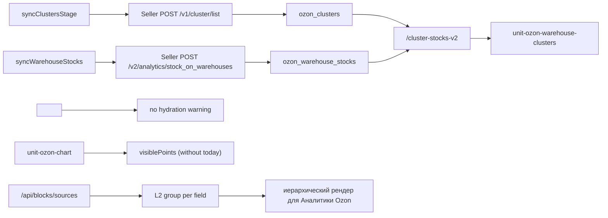

# MEMORY.md — Open Finance

> Актуальный handoff проекта. Читается вторым шагом bootstrap'а (после `START.md`). Должен давать полный рабочий контекст без reverse-engineering.

## Быстрый старт для AI-агента (bootstrap, ~6–8K токенов суммарно)
1. **`START.md`** — карта проекта, жёсткие правила, маршрутизация задач (~1.5K токенов).
2. **`MEMORY.md`** (этот файл) — текущее состояние, ключевые файлы, грабли (~5K токенов).
3. `git -C /Users/firay/open-finance/open-finance log --oneline -20` — последние коммиты.

После этих 3 шагов можно работать. Дальше — **только релевантное конкретной задаче** по таблице из `START.md`.

## Что НЕ загружать по умолчанию
- `CHANGELOG.md` (1199 строк) — только при вопросах про историю; иначе хватает `git log`.
- `PLAN.md` (1420 строк) — только при стратегических вопросах; читать через `Read offset+limit` нужный раздел, не файл целиком.
- `mempalace wake-up --wing open-finance` — индекс содержит и устаревшие версии проекта (Tauri-only, Prisma, Python sidecar). Использовать `mempalace search "конкретный вопрос" --wing open-finance` точечно для исторических вопросов.
- `docs/*` — каждый файл подгружается только когда задача его касается (см. таблицу маршрутизации в `START.md`).

## Перед работой с библиотеками
Context7: `mcp0_resolve-library-id` → `mcp0_query-docs`, не более 3 вызовов.

## После изменений
`pnpm build`, обновить `MEMORY.md` (если меняются ключевые файлы/инварианты/грабли) и `CHANGELOG.md`. **Никогда** не делать `git add/commit/push` самому — давать команды пользователю.

## Идентичность проекта
**Open Finance** — AI-первая модульная финансовая платформа для предпринимателей РФ.
- **Цель:** персональный AI-финансист уровня управляющего: анализирует, прогнозирует, предупреждает и помогает действовать.
- **Формат:** SaaS на Next.js сейчас; Local-First/Tauri 2.0 — Phase 2; mobile — Phase 3.
- **Аудитория:** селлеры OZON/WB/Я.Маркет, ИП, фрилансеры, самозанятые, малый бизнес РФ.
- **Главная фишка:** Block-Grid UI как Lego + AI поверх всех данных пользователя.
- **Продуктовый референс:** Notion + Linear по UX, Copilot Money/Cleo по AI, 1С-light/MPStats finance по рынку.

## Жёсткие правила проекта
- **Package manager:** только `pnpm`, не `npm`/`yarn`.
- **ORM:** только Drizzle ORM, **не Prisma**.
- **AI SDK:** своя обёртка/провайдеры, **не Vercel AI SDK**.
- **Multi-tenant:** `tenant_id` в каждой таблице и каждом DB-запросе.
- **AI-мутации:** только через Tools Layer (`src/lib/ai/tools/`), не прямой SQL из AI.
- **Git:** не выполнять `git add`, `git commit`, `git push`; только дать команды пользователю.
- **БД:** не запускать миграции автоматически; дать команды пользователю.
- **Секреты:** не коммитить `.env`, ключи, пароли, токены; читать `docs/SECURITY.md` при любой работе с секретами/сетью/биллингом.
- **Новые файлы кода:** начинать с `// PURPOSE: ...`.
- **Импорты:** явные, без `import * as X`.
- **Структура:** не делать глубокую вложенность `src/features/x/y/z`; бизнес-модули плоско в `src/modules/`.

## Актуальный стек
- **Frontend/API:** Next.js 15 App Router, React 18, TypeScript, RSC.
- **UI:** Tailwind CSS, shadcn/ui/Radix, Lucide, next-themes.
- **State:** Zustand + TanStack Query.
- **DB SaaS:** PostgreSQL 16 + pgvector, Drizzle ORM.
- **Cache/Queue:** Redis 7 + BullMQ.
- **AI:** Ollama local, OpenAI-compatible external providers, Claude/OpenRouter/VseGPT/custom through project provider layer.
- **AI streaming:** NDJSON from `/api/ai/chat`.
- **Spreadsheet/formulas:** `fast-formula-parser`, custom Sheet/Excel Cell blocks.
- **Charts:** Recharts.
- **Grid:** `react-grid-layout`.
- **Node:** `>=20`, package manager `pnpm@9.12.3`.

## Структура проекта
```text
src/
├── app/                  # Next.js App Router pages and API routes
│   ├── (app)/            # authenticated app shell
│   ├── (auth)/           # login/register/forgot
│   └── api/              # auth, blocks, cashflow, inbox, ai, boards
├── components/
│   ├── blocks/           # BlockGrid shell, chrome, dialogs, relation overlay
│   ├── micro-agent/      # AI micro-agent dialog
│   └── ui/               # shadcn primitives
├── lib/
│   ├── ai/               # providers, micro-agent, tools, memory stubs
│   ├── blocks/           # types, registry, catalog, values, relations
│   ├── boards/           # custom boards CRUD
│   ├── db/               # Drizzle client/schema
│   ├── inbox/            # IMAP, MIME, crypto, queries
│   └── env.ts            # typed env
└── modules/              # business modules: cashflow, inbox, communications
drizzle/init/             # manual SQL init: pgvector indexes, boards, inbox
```

## Block-Grid — фундамент UI
Open Finance = настраиваемый Lego-конструктор интерфейса. Почти каждая новая страница приложения должна строиться через `<BlockGrid />`, а не статичный layout.

### Ключевые файлы
- `src/lib/blocks/types.ts` — `BlockDef`, `BlockInstance`, `BlockDependencies`, `BlockAppearance`, `PageLayout`.
- `src/lib/blocks/registry.ts` — `ALL_BLOCKS`, `DEFAULT_LAYOUTS`, `getDefaultLayout`, `listBlocksForPage`.
- `src/components/blocks/block-grid.tsx` — drag/resize/save, relation overlay, AI dialog integration.
- `src/components/blocks/block-grid.css` — resize handle скрыт в обычном режиме; появляется через CSS `:has([data-resize-hotzone]:hover)` (40×40 hot-zone в правом нижнем углу `BlockChrome`) или сразу в edit mode. Анимация opacity 100мс, без задержек. Без JS-таймеров.
- `src/components/blocks/block-chrome.tsx` — wrapper, hover controls, settings/delete/AI.
- `src/components/blocks/block-settings-dialog.tsx` — настройки блока (4 таба: `params` → `links` → `style` → `ai`). Layout: `max-w-2xl` + `gap-0 p-0`, sticky header/footer. `StyleAndSizeForm` — двухколоночный header (preview-чип `200px` + title `1fr`), цвета `grid-cols-12` (расширенный `ACCENT_COLORS`: 25 цветов), иконки `grid-cols-12` (`ICON_NAMES`: 70 иконок, фон `bg-muted/40`, активная — `border-primary bg-primary/10`). `AiPromptForm` — uppercase-лейблы, textarea `rows=9`, badge `Тип·{blockType}`. Legacy `AppearanceForm` экспорт (для `AddBlockDialog`) синхронизирован с тем же стилем через `ColorSection` helper.
- `src/app/api/blocks/layout/[pageKey]/route.ts` — persist layout.
- `src/app/api/blocks/sources/route.ts` — sources для `@связать`, cross-page labels, Sheet formula evaluation.

### Инварианты Block-Grid
- Grid: 12 колонок, `rowHeight=40`, `margin=[10,10]`.
- Блоки должны иметь `defaultSize`, `minSize`, `minContentSize`.
- Render должен быть adaptive через `useBlockDensity()` (`xs/sm/md/lg`).
- Блок обязан уважать `instance.appearance`.
- Блоки публикуют значения через `useBlockValuePublisher`, если на них можно ссылаться.
- Связи обнаруживаются не только через `dependencies.sources`, но и через `config.blockRefs` и формулы с `@...`.
- **Не использовать `sanitizeBlocks` на сервере**: catalog/client exports могут быть пустыми в server bundle.
- **Координатная сетка-фон** (`.block-grid-surface`, [src/components/blocks/block-grid.css](src/components/blocks/block-grid.css), [src/components/blocks/block-grid.tsx](src/components/blocks/block-grid.tsx)): точки **строго совпадают с RGL-cells** (v0.15.0). `colW = (containerWidth - margin[0] * (cols - 1)) / cols`, `stepX = colW + margin[0]`, `stepY = rowHeight + margin[1]`, breakpoints/cols 1:1 как у RGL. ResizeObserver на surface пересчитывает inline-style `backgroundSize`/`backgroundPosition`. Радиальный градиент `circle at 5px 5px` + offset (colW, rowH) даёт дот в центре gap'а между ячейками. Контейнер имеет `data-edit` (режим редактирования) и `data-active` (drag/resize, через `onDragStart`/`onResizeStart` props RGL) — уровни видимости 0.18 → 0.30 → 0.50.
- **Cross-page связи в mindmap** (v0.15.0, refined v0.15.2, [src/components/blocks/block-relations-overlay.tsx](src/components/blocks/block-relations-overlay.tsx) + [src/lib/blocks/use-cross-page-relations.ts](src/lib/blocks/use-cross-page-relations.ts) + [src/app/api/blocks/relations/route.ts](src/app/api/blocks/relations/route.ts)): треугольнички ▶ зелёный (incoming, на левом ребре блока, apex внутрь) и ▶ индиго (outgoing, на правом ребре блока, apex наружу) появляются при включённом overlay'е «Связи». **Расположение (v0.15.2):** треугольники сидят НА ТОЙ ЖЕ ВЕРТИКАЛИ, что и anchor-кружочек edge-точки (`left = edgeX - TRI_SIZE/2`), но НИЖЕ кружочка по Y (`top = anchorCenterY + ANCHOR_R + ANCHOR_TRI_GAP = +10px`). Визуально читается как продолжение того же anchor-ряда: кружочек (локальные связи на странице) сверху, треугольник (cross-page связи) под ним. Кликабельные → popover со списком блоков-целей и `<Link href={pageHref(pageKey)}>`. Lightweight-эндпоинт `/api/blocks/relations` собирает `dependencies.sources` + `@`-refs из config (БЕЗ агрегаций). Хук `useCrossPageRelations(pageKey, enabled)` фетчит только при `enabled=true` (overlay видим), кэш per-pageKey.
- **`BlockChrome` рамка через absolute-overlay** (v0.15.2, [src/components/blocks/block-chrome.tsx](src/components/blocks/block-chrome.tsx)) — `appearance.borderColor` НЕ применяется через `boxShadow inset` на wrapper'е, потому что `bg-card` детей блока полностью перекрывает inset-shadow родителя. Вместо этого рендерится отдельный absolute-overlay `<div className="pointer-events-none absolute inset-0 z-20 rounded-lg" style={{ boxShadow: 'inset 0 0 0 2px {color}' }}>`. Он сидит на `z-20` поверх контента блока (z-0/z-10), но ниже chrome-контролов (`z-30`: drag-handle, AI/settings/X, CrossPagePin). `pointer-events-none` — клики проходят насквозь. Если добавляешь новый chrome-элемент с z-index — следи, чтобы было >20 для перекрытия рамки.
- **`BlockInstance.aiPrompt`** (master-промпт блока) обязан пробрасываться в `MicroAgentDialog.blockContext.aiPrompt` через `block-grid.tsx`. В `/api/ai/chat` приоритет: `aiPrompt > legacy config.blockPrompt > inline инструкция в диалоге`. Persistence: добавлено в `BlockInstanceSchema` API роута `/api/blocks/layout/[pageKey]`.

### Текущий каталог блоков
`stat.income`, `stat.expense`, `stat.balance`, `stat.custom`, `cashflow.top-categories`, `cashflow.transactions`, `sheet`, `excel.cell`, `navigate.card`, `computed.sum`, `custom.data`, `chart.cashflow`, `ai.micro-agent`, `inbox.channel-feed`, `unit.ozon-calculator`, `unit.ozon-multi-table`, **`unit.ozon-analytics`**, **`unit.ozon-kpi`**, **`unit.ozon-chart`**, **`unit.ozon-top-ads`**, **`unit.ozon-stock-clusters`**, **`unit.ozon-search-phrases`**, **`unit.ozon-campaigns`**, **`unit.ozon-data-health`**, **`unit.ozon-abc`**, **`unit.ozon-ai-insights`**, `unit.yandex-calculator`, `unit.my-store-table`, `currency.rates`. Каждый `BlockDef` помечен `tags: string[]`, `recommendedFor?: string[]`, `source: 'builtin'|'user'|'paid'` и **`iconName: string`** через карту `BLOCK_META` в `registry.ts` (источник правды для маркетплейса, `AddBlockDialog` и серверного рендера в RSC).

## Реализованные страницы и модули
- **Dashboard `/dashboard`** — BlockGrid с KPI и navigation cards.
- **Cashflow `/cashflow`** — CRUD/import транзакций, KPI, top categories, transactions, chart.
- **Inbox `/inbox`** — BlockGrid с двумя дефолтными блоками `inbox.channel-feed` размером `6×12`.
- **Boards `/boards`, `/boards/[boardId]`** — персональные доски на BlockGrid, `pageKey = board-{boardId}`.
- **Unit Economics `/unit-economics`** — четыре вкладки (`unit-economics-ozon`, `unit-economics-ozon-multi`, `unit-economics-yandex`, `unit-economics-my-store`), каждый таб = свой `pageKey` с самостоятельным BlockGrid layout.
- **Marketplace «Маркет блоков» `/marketplace`** — каталог всех блоков (browse-only, без установки). `src/app/(app)/marketplace/{page,marketplace-client}.tsx`. Поиск, фильтр по категории и тегам, диалог детальной инфо. Кнопки «Создать блок» и «Купить блок» disabled (заглушки на будущее). Пункт sidebar `marketplace` с label «Маркет блоков» (`Store` icon). URL `/marketplace` сохранён ради ссылок и истории.
- **Settings `/settings`** — visibility toggles, форматирование, настройки разделов.
- **Settings → Integrations `/settings/integrations`** (v0.17.0) — подключение marketplace-аккаунтов (Ozon Seller API), тогглы синхронизации по 7 стейджам, тест/sync/история job'ов.
- **Admin AI pages** — local models, external providers/proxy/diagnostics, system prompt.

## Boards — персональные рабочие пространства
- `src/lib/db/schema/boards.ts` — таблица `boards`.
- `src/lib/boards/queries.ts` — CRUD, reorder, pinned.
- `src/lib/boards/utils.ts` — `boardPageKey(boardId)` → `board-{id}`.
- `src/app/api/boards/route.ts`, `src/app/api/boards/[boardId]/route.ts` — API.
- `src/app/(app)/boards/*` — pages/client UI.
- `drizzle/init/03-boards.sql` — manual SQL.
- Запиненные доски отображаются в sidebar; доски видны в `@связать` через `/api/blocks/sources`.

## Sheet / Excel Cell / Custom Data / связи
- `sheet` — мини-таблица с формулами, `@связать`, computed cells в sources API, `__money` metadata для денежных ячеек. Без `minContentSize` — таблица скроллится внутри блока любого размера (`minSize: 1×1`).
- `excel.cell` — компактная одиночная Excel-like ячейка `3×2`, формулы и `moneyRefs`.
- `custom.data` (v0.14.0, расширен v0.15.0) — **multi-column** блок «Данные» c `Config = { columns: Array<{id, label, format: 'rubles'|'number'|'percent'|'text', publish, width?}>, rows: Array<{id, label, cells: Record<colId, {v, ref?, isMoney?}>}>, publishMode, publishColumnId, showKopecks, labelColumnWidth? }`. Каждая ячейка может быть либо ручной (`v`), либо привязкой (`ref` + cached `v` + `isMoney` флаг — мигрировано из `excel.cell.moneyRefs`). На hover ячейки появляется `@`-кнопка для открытия picker'а. Per-column publish: каждая `publish:true` колонка публикует свой агрегат как `{column.id}` (доступен в `@связать` как `@блок.amount`/`@блок.stock`). Legacy `value` = агрегат основной колонки (`publishColumnId`). `parseConfig` мигрирует все старые конфиги (`rows[i].value` + top-level `format`) при чтении. **Адаптивные ширины колонок (v0.15.0):** label и value-колонки автоматически подгоняются по самому длинному значению через `canvas.measureText` (общий контекст модуля, SSR-safe, диапазон label 80-240px / value 72-220px); manual override через drag-handle на правом ребре header'а (pointer-капчер + локальный `dragState` без записи в config до pointerUp) или через `column.width`/`labelColumnWidth` в SettingsForm; кнопка **«A»** (`Maximize2`) в шапке блока сбрасывает все ручные widths.
- **Money detection через `moneyRefs`/`isMoney`**: `sheet`/`excel.cell` сохраняют `moneyRefs: Record<string, boolean>` в config; `custom.data` хранит флаг per cell в `cells[colId].isMoney`. Все используют общий `sourceFieldIsMoney(block, field)` при выборе через picker. То же mirror на server-side в `/api/blocks/sources/evaluateSheetCells`.
- **Публикация `__money`**: KPI-блоки (`stat.*`, `computed.sum`, `custom.data` с rubles-колонками, `excel.cell` с money формулой) публикуют `__money: 'col1,col2,...'` (включая `value` если основная колонка денежная) через `useBlockValuePublisher`. `__labels: 'amount=Сумма,stock=Остаток,...'` для красивого отображения в picker'ах.
- `/api/blocks/sources` server-side считает Sheet formulas, включая linked cells, чтобы вкладки страниц совпадали с live current-page values.
- `useAvailableBlockSources()` скрывает служебные поля вроде `__money`/`__labels`.
- Формат денег нельзя выводить из факта `@`; нужен explicit `format: money` (server) / сохранённый `moneyRefs`/`isMoney` (client), иначе обычные ячейки будут ошибочно делиться на копейки.

## AI Micro-Agent и AI runtime
### Ключевые файлы
- `src/app/api/ai/chat/route.ts` — NDJSON streaming endpoint, route Ollama vs External, `parseAction()`.
- `src/components/micro-agent/micro-agent-dialog.tsx` — dialog с streaming preview, Stop, token counter.
- `src/lib/blocks/catalog/ai-micro-agent.tsx` — standalone AI block.
- `src/lib/ai/micro-agent/block-capabilities.ts` — capability registry для block configs.
- `src/lib/ai/providers/ollama.ts` — installed models + `isChatCapableModel()`.
- `src/lib/ai/providers/openai-compat.ts` — SSE → NDJSON для OpenAI-compatible API.
- `src/lib/ai/providers/proxy.ts` — runtime `undici` ProxyAgent.

### Поведение
- `/api/ai/chat` отдаёт события `start`, `token`, `done`, `error`, `aborted`.
- Local Ollama: приоритет request `model` → tenant `aiModel` → env `OLLAMA_DEFAULT_MODEL` → первая chat-capable.
- Embedding-модели фильтруются; если установлены только embeddings, ошибка понятная.
- External: если `tenant.settings.aiExternal.enabled` и есть key/baseUrl, используется `streamOpenAICompat()`.
- `parseAction()` понимает fenced/unfenced JSON, `payload`/`config`, `update_block`, `create_block`, `text_only`.
- `BlockGrid` умеет применять `update_block` и создавать блок по `create_block`.

## AI Providers Hub
- `/admin/ai/local-models` — каталог 19 моделей по категориям, HF input, installed/running/details, выбор основной локальной chat-модели.
- `/admin/ai/providers` — external API presets: OpenAI, Claude, OpenRouter, VseGPT, Custom; proxy HTTP/HTTPS; diagnostics.
- `/admin/ai/system-prompt` — общий system prompt tenant'а.
- Tenant settings JSONB: `aiProvider`, `aiModel`, `aiSystemPrompt`, `aiExternal{enabled,provider,baseUrl,apiKey,defaultModel,useProxy}`, `aiProxy{enabled,url,type,username,password}`.
- В MVP внешние API keys/proxy password в `tenants.settings` plain JSONB и маскируются на клиенте; production TODO: AES-256-GCM/Vault.

## Inbox Channels MVP
### Ключевые файлы
- `src/lib/db/schema/inbox.ts` — `inbox_channels`, `inbox_messages`, tenant scoping, `created_by`, unique `(channel_id, external_id)`.
- `src/lib/inbox/queries.ts` — tenant-scoped CRUD/sync/list messages; channels scoped per block через `config.blockId`.
- `src/lib/inbox/crypto.ts` — AES-256-GCM secret encryption using `INBOX_SECRET_KEY`, dev-only fallback.
- `src/lib/inbox/imap.ts` — IMAP connect/test/sync, STARTTLS, Beget fallback.
- `src/lib/inbox/mime.ts` — MIME headers/body decode, Cyrillic fallback.
- `src/lib/blocks/catalog/inbox-channel-feed.tsx` — `inbox.channel-feed` block settings and feed UI.
- `src/app/api/inbox/channels/route.ts`, `src/app/api/inbox/messages/route.ts` — API.
- `src/lib/ai/tools/query-inbox-messages.ts` — read-only AI tool.
- `drizzle/init/04-inbox.sql` — manual SQL.

### Состояние
- Email IMAP MVP готов: test connection, sync recent messages, per-message FETCH для кириллицы/literal-length reliability.
- Пароль канала шифруется; UI показывает masked secret.
- SSL/TLS off использует STARTTLS; Beget `imap.beget.com:993` timeout retry → `143 + STARTTLS`.
- Telegram channel пока placeholder.
- Подключение каналов живёт в настройках конкретного `inbox.channel-feed` блока, не в общей settings-секции.

## Unit Economics (MVP, v0.13.0)
### Ключевые файлы
- `src/lib/unit-economics/types.ts` — `Marketplace`, `OzonMode`, `YandexMode`, `TaxMode` (4 опции, `'nds'` УДАЛЁН), `OzonFbsDropoffPoint` (2 опции: `sorting_center`/`pickup_point`), `OzonFbsShipmentSpeed`, `OzonFbsClusterShare = {key, sharePct}`, `OzonInputs/Results` (multi-cluster + `returnsPct/cancelPct/coInvestPct/freeAcceptance/supplyLeadWeeks/documentedExpensesMonth/indirectExpensesMonth`, в результатах `priceWithSpp/coInvestSavings/effectiveBuyoutPct`), `YandexInputs/Results`, `UnitCellBinding`, утилиты.
- `src/lib/unit-economics/ozon/{tariffs-2026-04-07,calculate,migrate}.ts` — версионированный тарифный пак (`OZON_TARIFF_VERSION = ozon_2026_04_07`) и pure-TS engine. **28 кластеров FBS** (`FBS_CLUSTERS` с `local: boolean` + `region`), 43-уровневый `VOLUME_BRACKETS` LUT для FBO/FBS, `OZON_CLUSTER_PRESETS` (`allRf/topRf5/topRf10/geography`), `NON_LOCAL_CLUSTER_MULTIPLIER = 1.25`, `PAID_ACCEPTANCE_FEE_PER_UNIT_RUB = 10`. `calculateOzon` использует **multi-cluster weighted-sum логистику**: `Σ baseLogistics × clusterMultiplier × share/totalShare` + fallback к single через `isLocalCluster` если `fbsClusters` пуст. `migrate.ts → migrateOzonRaw()` мигрирует старые конфиги (`fbsWarehouse → fbsClusters[]`, `taxMode 'nds' → 'osno'`, `taxDeductExpenses → documentedExpensesMonth=0`, `fbsDropoffPoint 'ozon_warehouse' → 'sorting_center'`).
- `src/lib/unit-economics/yandex/{tariffs-2026-04-01,calculate}.ts` — то же для Yandex, НДС от `customerPrice`.
- `src/lib/unit-economics/bindings.ts` — `isBindingActive`, `bindingScopedKey`, `resolveBindingValue` (kopecks→rubles по флагу `money`), `bindingHasValue`.
- `src/lib/unit-economics/use-live-block-values.ts` — `useAllBlockValuesFlat` (live из `BlockValuesContext`), `useRemoteBlockSources` (`/api/blocks/sources`).
- `src/lib/unit-economics/import/ozon-price-template.ts` — XLSX-парсер с SheetJS + fallback ZIP/XML.
- `src/lib/unit-economics/store-formula.ts` — evaluator формул для блока «Мой магазин»: `evalSingleFormula`, `evalRowFormulas`, защита от циклов (`'#CYCLE'`), идентификаторы заменяются по убыванию длины ключа.
- `src/lib/unit-economics/queries.ts` — tenant-scoped CRUD `unit_products`/`unit_calculations`/`unit_imports`, `bulkUpsertUnitProducts`.
- `src/lib/db/schema/unit-economics.ts` — Drizzle-таблицы (деньги в копейках `integer`).
- `drizzle/init/05-unit-economics.sql` — manual SQL.
- `src/app/api/unit-economics/{products,calculations,import/ozon-prices}/route.ts` — API.
- `src/lib/blocks/catalog/{unit-ozon-calculator,unit-ozon-multi-table,unit-yandex-calculator,unit-my-store-table}.tsx` — блоки. Оба Ozon-блока вызывают `migrateOzonRaw()` в `parseConfig`.
- `src/components/unit-economics/{unit-cell-binding-dialog,linkable-number-cell,dropdown-select,cluster-selector}.tsx` — UI привязок и multi-cluster селектор. `<ClusterSelector>` — DropdownMenu с popover-чекбоксами для всех 28 кластеров, % инпутами, индикатором суммы (зелёный 100% / оранжевый иначе), кнопкой «Нормализовать», quick-пресетами.
- `src/app/(app)/unit-economics/{page,unit-economics-client}.tsx` — server + client страница (4 таба).
- `scripts/test-unit-economics.ts` — smoke tests, **36 PASS** (запуск: `pnpm tsx scripts/test-unit-economics.ts [path-to-xlsx]`).

### Инварианты
- **Версионирование тарифов:** сохранённые `unit_calculations.tariff_version` ссылаются на конкретный pack (`ozon_2026_04_07`, `yandex_2026_04_01`); при добавлении нового pack — не перезаписывать старые расчёты.
- **Деньги:** в БД хранить в копейках (`integer`), в `inputs/results` JSONB — рубли с `money: true` пометкой при необходимости. UI форматирует через существующие helpers.
- **НДС vs Налог:** `vatPct/vat` — отдельная строка расхода, не зависит от taxMode. `taxRatePct/tax` — налог на прибыль (УСН/ОСНО). Не объединять. Налоговый режим `'nds'` УДАЛЁН (v0.13.0) — только `usn_income/usn_income_minus/osno/none`.
- **Multi-cluster FBS (v0.13.0):** `OzonInputs.fbsClusters: Array<{key, sharePct}>` — массив кластеров с долями, sum должна быть = 100. `calculateOzon` нормализует фактическую сумму, поэтому 50/30/20 при totalShare=100 работает корректно. Если массив пуст — fallback к single через `isLocalCluster`. **Старое** поле `fbsWarehouse` оставлено только в типе как `@deprecated` для миграции через `migrateOzonRaw()`. UI всегда пишет в `fbsClusters`.
- **Новые поля Ozon (v0.13.0):** `returnsPct + cancelPct` → derived `effectiveBuyoutPct = 100 - sum`; legacy `buyoutPct` используется только если оба = 0. `coInvestPct` — компенсация баллами Ozon (положительная P&L строка). `freeAcceptance: false` + FBS = +10₽/ед к логистике. `documentedExpensesMonth` (₽/мес) — для УСН Д-Р вычета на единицу через `salesPerMonth`. `priceWithSpp` (== buyerPrice) — явная метрика «Цена с СПП».
- **FBS shipment speed (v0.12.0):** `OzonInputs.fbsShipmentSpeed='fast'` даёт `+FBS_FAST_SHIPMENT_COMMISSION_BUMP_PCT(=2)` к комиссии (только при `mode='fbs'`). Все FBS-поля опциональные.
- **Linkable cells:** money-флаг обязателен для денежных привязок, иначе будет повторение бага «деление/не деление на 100». Fallback хранится при пропадании источника, показывается warning state. Внутри ячейки **всегда** `<input>` (в linked — readOnly + onClick → picker), иначе вернётся сдвиг между manual и linked.
- **Sticky cells в unit-таблицах (v0.12.1):** background всегда **solid** `bg-card` (без `/95`, без `backdrop-blur`); каждая sticky-ячейка имеет `overflow:hidden isolate` (новый stacking-context). Геометрия фиксируется явно: sticky widths `32/110/220`, `HEADER_H=42`, `ROW_H=30`, `minWidth/maxWidth/boxSizing` на header/body/totals. z-index: header sticky `45`, totals row `35`, body sticky `30`, sticky totals `36`. На последней sticky-колонке — `boxShadow: '1px 0 0 0 var(--border)'`. Важно: **не возвращать** `[&:hover_[data-sticky]]:bg-accent/5` или другой полупрозрачный hover на sticky-cells — он снова покажет скроллящийся текст под `Артикул/Название`. Inputs Артикул/Название имеют `truncate`.
- **Select-ы в юнит-блоках (v0.12.2):** ВСЕ выпадающие списки (FBS-параметры, Налог, Спецтариф) — через `DropdownSelect` (`src/components/unit-economics/dropdown-select.tsx`, обёртка над Radix `DropdownMenu`). Не возвращать нативные `<select>` — на macOS/iOS они рендерят пустую метку в закрытом состоянии при заполненном value, даже с `text-foreground [color-scheme:light]`.
- **Bulk fill колонок (v0.12.2):** Ozon multi — `MoreVertical` в `SortableHeaderCell` (только для input-колонок), открывает `DropdownMenu` с input + Apply. My Store — секция «Массовое заполнение» в `ColumnEditDialog` (disabled для type=`formula`). Оба обработчика обязаны **пропускать** строки с активным `bindings[field]` (биндинг приоритетнее) и возвращать `{ applied, skipped }` для inline-фидбэка.
- **Column DnD (Ozon multi-table):** порядок input-колонок и result-колонок хранится отдельно в `config.global.columnOrder = { inputs: string[]; results: string[] }`. `resolveColumnOrder<T>()` мерджит сохранённый порядок с дефолтом — новые колонки идут в конец, удалённые — выкидываются. Sticky `#`/Артикул/Название/Действия не drag'аются. Drag handle (`GripVertical`) внутри `SortableHeaderCell` появляется при hover, активируется через `PointerSensor` с `distance: 5`. Input и result колонки нельзя смешивать (отдельные `DndContext`). У каждого `DndContext` должен быть стабильный `id` на основе `instance.id`, иначе `@dnd-kit` может дать hydration mismatch по `aria-describedby`.
- **XLSX-импорт Ozon:** маппинг колонок по заголовкам, не индексам. SheetJS читать с `cellStyles: false`. Fallback ZIP/XML парсер обходит «битый» stylesheet от Ozon. Фильтровать служебные строки-метки.
- **Tenant isolation:** все API под `auth()`, все DB-запросы фильтруются по `tenant_id`. `unit_products` upsert по `(tenant_id, marketplace, article)`.
- **Aggregate outputs:** все unit-блоки публикуют через `useBlockValuePublisher` с `__money` для денежных полей и **`__labels`** convention `"key=Human Label,..."` для picker привязок. Ozon multi: `rowsCount`, `avgMargin`, `avgRoi`, `totalProfitMonth`, `totalStockValue`, `totalMoneyInGoods`. My Store: `rowsCount`, `totalRevenue`, `totalProfit`, `avgMargin`, `stockTotal`. Calculators: `profitPerUnit`, `profitPerMonth`, `margin`, `roi`. `useAvailableBlockSources()` парсит `__labels` в `Record<string,string>`; `unit-cell-binding-dialog` использует `labels[field] ?? sourceFieldLabel(field)`.
- **`/api/blocks/sources`:** `unit-economics-*` page labels и `unit.*` type labels (включая `unit.my-store-table`) в `DEFAULT_PAGE_KEYS`/`PAGE_LABELS`/`TYPE_LABELS`. `fieldsForBlock` возвращает publishable поля.
- **My Store column model:** `{ id, label, type: 'number'|'percent'|'money'|'text'|'formula', unit?, default?, width?, formula?, positive?, hidden? }`. `formula`-колонки read-only, не биндятся. Доступные переменные в формулах: id колонок текущей строки + `vatPct`, `taxRatePct`. Защита от циклов → `'#CYCLE'`.
- **Yoolip credentials:** не хранить в git/плане. Только email + факт наличия тестового доступа в плане; пароль — вне репозитория.
- **Файл `СЕБЕС озон.xlsx`:** референс для парсера колонок «Мой магазин», парсер пока не реализован — отдельный заход.

## Currency Rates (v0.16.0)
### Ключевые файлы
- `src/lib/db/schema/currency.ts` + `drizzle/init/06-currency.sql` — таблица `currency_rates` (НЕ tenant-scoped, общая на инстанс). PK = `code` (varchar(8)), `rate_rub` numeric(18,6) хранится как **курс за 1 единицу** (не за nominal).
- `src/lib/currency/sources/cbr.ts` — `fetchCbrDaily()`: тянет JSON у `cbr-xml-daily.ru/daily_json.js` (community-mirror ЦБ, без ключа/лимитов), нормализует `Nominal>1` → курс/единицу, таймаут 8s + 1 retry с задержкой 800ms.
- `src/lib/currency/queries.ts` — `getCurrencyRates(codes?)`, `getStaleness()` (порог 23h), `refreshCurrencyRates()` с bulk upsert через `onConflictDoUpdate({ target: code, set: { ...sql\`excluded.field\` } })`.
- `src/app/api/currency/rates/route.ts` — `GET`: snapshot из БД + lazy-refresh при возрасте >23h (асинхронный, через глобальный `inflightRefresh: Promise|null` от параллельных вызовов).
- `src/app/api/currency/rates/refresh/route.ts` — `POST`: принудительный refresh, rate-limit 1/min per tenant через in-memory `Map<tenantId, lastRefreshAt>`. При ошибке fetch → 502.
- `src/lib/blocks/catalog/currency-rates.tsx` — блок `currency.rates`. Density-aware Render (xs → primaryCode/RUB; sm → код+курс; md/lg → список со стрелками тренда + Δ%). Settings: 9 «популярных» (USD/EUR/CNY/AED/TRY/GBP/JPY/KZT/BYN) + кнопка «Остальные валюты ЦБ» открывает диалог с search'ем по всем ~30. Кнопка `RefreshCw` в шапке блока — manual refresh.

### Инварианты
- **`rate_rub` всегда нормализован к 1 единице.** ЦБ возвращает `Nominal=10` для KRW/JPY/HUF/IDR — `fetchCbrDaily()` делит `Value/Nominal`. Поле `nominal` в БД оставлено справочно для UI.
- **Курс — НЕ money-формат.** Блок публикует все курсы как `format: 'number'` (через `useBlockValuePublisher` + `__labels`, БЕЗ `__money`). Это важно: формула `=A1*@currency.usd` корректно работает только когда A1 — money, а курс — обычное число (90.5). Если курс пометить как money, `formatRublesWithSettings` поделит его на 100 и получится 0.9 ₽.
- **Lazy-refresh окно — 23h** (`CURRENCY_STALENESS_WINDOW_MS`), не 24h. ЦБ обновляет курсы около 11:30 МСК, защита от случая «вчера в 23:59 обновили, сегодня в 11:00 решили не обновлять».
- **Авто-refresh при первом открытии блока** — `useCurrencyRates()` детектит пустой `rates={}` после первого `load()` и вызывает `refresh()` автоматически. Это страхует кейс «БД ещё пуста, пользователь только что добавил блок». В обычном работающем инстансе lazy-refresh при `GET` поддерживает БД свежей.
- **Money detection потребителем**: `sourceFieldIsMoney()` в `custom-data.tsx` → если `field.format === 'number'` (а у currency.rates все fields явно `'number'`), возвращает `false`. Дополнительные категории (`'Финансы'`) добавлять в isMoney-эвристику НЕ нужно.
- **`/api/blocks/sources` подгружает курсы 1 раз**: `getCurrencyRates()` вызывается в начале `GET`, результат кэшируется в `currencyRatesByCode: Map<string, CurrencyRate>` и пробрасывается в каждый `fieldsForBlock(...)`. Не делать этот вызов внутри `fieldsForBlock` — иначе на 50 блоков будет 50 SQL-запросов.

## Marketplace Integrations / Ozon Seller API (v0.17.0 → v0.17.2)
### v0.17.2: полный аудит sync + блок аналитики
- **Sync clobbering bug fixed.** Поэтапная синхронизация (stages products → prices → stocks) больше не обнуляет уже загруженные значения. Конкретика: `onConflictDoUpdate.set` теперь conditional с `sql\`unit_products.X\`` fallback. См. подробности в секции «Блок `unit.ozon-multi-table`» выше.
- **Sync settings перенесены в `BlockDef.SettingsForm`** (таб «Параметры» Settings-диалога). Toolbar-кнопка «Настройки Ozon» убрана; `OzonSyncSettingsDialog` сохранён как back-compat для preview's «Edit settings».
- **`stockSource`** добавлен в `SyncSettingsSchema` — 4 политики выбора остатка с mode-aware default. См. FBO/FBS таблицу выше.
- **Новый блок `unit.ozon-analytics`** (read-only аналитика per-product). См. секцию «Блок `unit.ozon-analytics`» выше.
- **+109 smoke-тестов** в `scripts/test-ozon-{upsert,sync-diff,analytics}.ts`.

### v0.17.1: робастность + продвинутая интеграция блока
- **`OzonClient.post()` lenient по умолчанию** ([`client.ts`](src/lib/marketplaces/ozon/client.ts)) — на Zod safeParse fail НЕ throw, а `console.warn` + return raw JSON. Опт-ин `{ strict: true }` для критичных endpoints. 4xx/5xx по-прежнему throw `OzonApiError`. Грабля: если sync рандомно падает с «schema mismatch», скорее всего Ozon добавил новое поле или поменял тип — добавить `.passthrough()` или `union`.
- **`SellerInfoSchema` двушаговая** ([`types.ts`](src/lib/marketplaces/ozon/types.ts)) — принимает и `{ result: {...} }`, и плоский ответ. Downstream код извлекает `info.result ?? { name, company_id, is_enabled }` (см. [`test/route.ts`](src/app/api/marketplaces/accounts/[id]/test/route.ts)).
- **`primary_image: string | string[]`** ([`types.ts`](src/lib/marketplaces/ozon/types.ts), [`upsert.ts`](src/lib/marketplaces/ozon/upsert.ts)) — c 2026-05 Ozon отдаёт массив URL. `normalizePrimaryImage()` нормализует к массиву; в metadata пишем `primaryImage` (первый) + `images` (полный список, приоритет `info.images`).
- **`upsertUnitProductFromOzon()` теперь возвращает `boolean`** — `false` если `info.id` или `info.offer_id` отсутствует. Грабля: prices/stocks стейджи игнорируют возврат (продолжают `await`-ить); products стейдж считает skipped и пишет в `warnings`.
- **`RATE_LIMITERS` cleanup** ([`client.ts`](src/lib/marketplaces/ozon/client.ts)) — `lastUsedAt` + opportunistic cleanup лимитеров старше 1ч при создании нового. Без `setInterval` (для serverless).
- **`OzonKeyHelp`** ([`src/components/integrations/ozon-key-help.tsx`](src/components/integrations/ozon-key-help.tsx)) — мини-инструкция для пользователя «Где взять Client-Id/Api-Key», роль **Admin read only** (238 методов), 180 дней. Две версии: `full` (страница интеграций) и `compact` (диалог создания).
- **`config.sync` в `unit.ozon-multi-table`** ([`unit-ozon-multi-table.tsx`](src/lib/blocks/catalog/unit-ozon-multi-table.tsx)) — Zod-схема с `.default()` (backward-compat для старых конфигов): `accountId`, `conflictPolicy` (`overwrite`/`fill-empty`/`skip`), `matchBy` (article|sku), `treatZeroAsEmpty`, **`stockSource`** (`mode-aware`/`fbo`/`fbs`/`sum`, default `mode-aware`), `columnMap` по 9 полям. Экспортируется `OzonBlockSyncSettings` тип и `OZON_BLOCK_SYNC_SETTINGS_DEFAULT`.
- **`OzonSyncSettingsForm`** ([`ozon-sync-settings-form.tsx`](src/components/unit-economics/ozon-sync-settings-form.tsx)) — **pure UI** настроек sync, без Dialog-обёртки. Используется в `BlockDef.SettingsForm` блока (таб «Параметры» Settings-диалога блок-грида) **и** в legacy `OzonSyncSettingsDialog` (для «Edit settings» из preview). Авто-fallback на первый магазин если pinned `accountId` удалён (с warning). Radio-секция «Источник остатка» с inline-подсказкой какой буфер реально подставится в текущем mode блока.
- **FBO/FBS семантика остатка в sync** — `stockSource` управляет тем, что попадёт в `Stock` колонку блока:
  | `stockSource` | mode=fbo | mode=fbs |
  | -- | -- | -- |
  | `mode-aware` (default) | `stockMarketplace` (FBO склады Ozon) | `stockOwn` (FBS + cross-border) |
  | `fbo` | `stockMarketplace` | `stockMarketplace` |
  | `fbs` | `stockOwn` | `stockOwn` |
  | `sum` (legacy) | `stockMarketplace + stockOwn` | `stockMarketplace + stockOwn` |
  Помощник `resolveStock(product, mode, stockSource)` в [`ozon-sync-diff.ts`](src/components/unit-economics/ozon-sync-diff.ts), 7 тестов покрывают все комбинации.
- **`planUnitProductUpsertFromOzon()`** ([`upsert-plan.ts`](src/lib/marketplaces/ozon/upsert-plan.ts)) — **pure function** план upsert'а для `unit_products`, выделена из `upsert.ts` чтобы тестироваться без env/db. Возвращает `{insert, updates: {field: 'fresh'|'keep'}, metadataDelta}`. **Критическая инвариантность:** в `onConflictDoUpdate.set` каждое поле (priceKopecks/volumeL/stockMarketplace/stockOwn/visibility) обновляется только если payload его принёс; иначе fallback на текущее значение в БД через `sql\`unit_products.X\``. Раньше поздние стейджи (`prices`/`stocks`) обнуляли поля от ранних стейджей — баг проявлялся как «preview показывает все нули». 47 unit-тестов в [`scripts/test-ozon-upsert.ts`](scripts/test-ozon-upsert.ts).
- **`buildSyncDiff()`** ([`ozon-sync-diff.ts`](src/components/unit-economics/ozon-sync-diff.ts)) — **pure-function** diff между rows блока и продуктами Ozon. Возвращает `{ totals, changes[], resultRows }`. Не делает побочных эффектов — 32 unit-теста покрывают все политики + edge cases (треат-zero, mode fbo/fbs, case-insensitive matching, matchBy fallback, **stockSource**). Тесты в [`scripts/test-ozon-sync-diff.ts`](scripts/test-ozon-sync-diff.ts), запуск `pnpm tsx scripts/test-ozon-sync-diff.ts`. Грабля: `commissionPct` берётся из `metadata.commissions.{fboPct|fbsPct}` в зависимости от `mode` блока — диалог настроек подсказывает это пользователю.
- **`OzonSyncPreviewDialog`** ([`ozon-sync-preview-dialog.tsx`](src/components/unit-economics/ozon-sync-preview-dialog.tsx)) — детальное превью перед применением: 4 summary-карточки + filter-pills + scrollable таблица 7 колонок (Артикул · Название · Колонка · Было · → · Станет · badge). Пагинация по 200 строк. Кнопка «Изменить настройки» открывает legacy `OzonSyncSettingsDialog` (back-compat).
- **`BlockDef.SettingsForm` блока** ([`unit-ozon-multi-table.tsx`](src/lib/blocks/catalog/unit-ozon-multi-table.tsx)) — `UnitOzonMultiTableSettingsForm` использует `OzonSyncSettingsForm`, в табе «Параметры» Settings-диалога блок-грида. Toolbar-кнопка «Настройки Ozon» **убрана** в v0.17.2 — настройки теперь стандартным механизмом через gear-иконку блока.
- **Toolbar `unit.ozon-multi-table`** — кнопка «Синхронизировать» (`OzonSyncButton` с `accountId={config.sync.accountId}`, после job → `buildDiffAndOpenPreview()`). Кнопки «Настройки Ozon» больше нет — она была заменена SettingsForm в табе «Параметры».
- **`/api/unit-economics/products?include=aggregates&accountId=…`** ([`products/route.ts`](src/app/api/unit-economics/products/route.ts)) — JOIN `ozon_orders` через LATERAL `jsonb_array_elements(items)`, считает `salesPerMonth` (delivered за 30д) и `buyoutPct` (delivered / total за 90д, минимум 5 заказов). **`tenant_id` явно в WHERE** + опциональный `account_id` фильтр. Грабля: `db.execute()` возвращает разные формы в зависимости от драйвера — поддержали обе (`Array.isArray(r) ? r : r.rows`).
- **`OzonSyncButton` accountId/label props** ([`ozon-sync-button.tsx`](src/components/unit-economics/ozon-sync-button.tsx)) — `accountId?: string | null` (pinned), `mountedRef` для setState-safety. Если accountId удалён → fallback к первому активному + amber-warning под кнопкой.

### Блок `unit.ozon-analytics` (read-only аналитика per-product)

Отдельный блок, **не** связанный с калькулятором юнит-экономики. Показывает per-product выручку/заказы/рекламу/ДРР/остатки за выбранный период. Создан в v0.17.2 чтобы не перегружать unit-блок аналитикой.

- **`UnitOzonAnalyticsBlock`** ([`unit-ozon-analytics.tsx`](src/lib/blocks/catalog/unit-ozon-analytics.tsx)) — BlockDef с Render + SettingsForm. Pages: `unit-economics-ozon-multi` + `*`, иконка `BarChart3`.
- **Config схема** ([`unit-ozon-analytics-types.ts`](src/lib/blocks/catalog/unit-ozon-analytics-types.ts)) — `accountId`, `periodPreset` (today/yesterday/7d/14d/30d/mtd/custom), `customFrom`/`customTo`, `defaultFilter`, `visibleColumns`. Также экспортирует pure-helpers `resolvePeriod()` и тип `OzonAnalyticsRow` (чтобы тесты и client-only файлы не тянули route).
- **API `/api/marketplaces/analytics/ozon`** ([`route.ts`](src/app/api/marketplaces/analytics/ozon/route.ts)) — tenant-scoped, GET `?accountId&from&to`. Один SQL с тремя CTE: `order_items` (LATERAL `jsonb_array_elements(ozon_orders.items)`), `agg_orders` (delivered/cancelled/returned/qty/revenue), `agg_ads` (transactions с `lower(operation_type) LIKE '%promot%|%advertis%|%marketing%'`). Spine — `unit_products`, LEFT JOIN на `agg_orders.offer_id = up.article` и `agg_ads.sku = up.sku`. Возвращает `rows[]` + `totals` (revenue/ads/drr/delivered/cancelled/returned/productsWithSales).
- **Расчёт DRR/buyout/daysOfStock** делается **в Node**, не в SQL, чтобы было проще тестировать. ДРР = `ads / revenue * 100`; null если revenue=0 или ads=0. Buyout = `delivered / (delivered+cancelled+returned)`; null если total < 5 (статистически нерепрезентативно). DaysOfStock = `stock / (qty_delivered / period_days)`; null если velocity=0.
- **`ozon-analytics-filters.ts`** — 8 smart-фильтров (`all`/`with-ads`/`high-drr` (>20%)/`no-ads` (с продажами)/`low-stock` (<14d)/`no-stock` (=0)/`no-orders` (delivered=0)/`unprofitable` (drr>100%)). Pure-функции, тестируются.
- **`ozon-analytics-table.tsx`** — таблица с сортировкой, баджами (4 цвета для ДРР: good/ok/warning/danger; 5 цветов для stock days). 13 колонок: article/name/price/cost/margin/orders/qty/revenue/ads/drr/stock/days/buyout. Sort: null/empty всегда в конец.
- **Period picker** в Render — кнопки + `input[type=date]` для custom. Totals header (5 карточек). Filter chips с counts. XLSX-экспорт через `xlsx` (имя файла `ozon-analytics_YYYY-MM-DD_YYYY-MM-DD.xlsx`).
- **`mountedRef`** в Render защищает setState после unmount. **Deleted-account fallback** в SettingsForm — если сохранённый `accountId` не существует, автоматически переключается на первый доступный.
- **Тесты:** 29 PASS в [`scripts/test-ozon-analytics.ts`](scripts/test-ozon-analytics.ts) — все 8 фильтров, config schema (включая backward-compat), `resolvePeriod` все пресеты. Запуск `pnpm tsx scripts/test-ozon-analytics.ts`.
- **`JobErrorsBlock`** в `/settings/integrations` — раскрываемый список ошибок job'a с stage-badge. Info-tooltip для «schema mismatch» сообщений (после lenient-mode они = warnings).

### Аналитика блока: CPO + FBO/FBS + compareMode (v0.18.16)

**Блок Аналитика (`unit-ozon-analytics`)** — `src/app/api/marketplaces/analytics/ozon/route.ts`:
- **CPO в totals**: отдельный CTE-запрос `SUM(expense_kopecks) FROM ozon_perf_cpo_daily` → `cpoTotalRub`. Прибавляется к `totals.adsRub`.
- **CPO per-SKU распределение** (Node, не SQL): `adsCpoAllocRub = cpoTotalRub * (row.revenueRub / totalRevenueForAlloc)`. Если выручки нет — CPO остаётся только в totals. Per-row `drrPct` пересчитан с учётом CPO.
- **FBO/FBS из ozon_orders.scheme**: CTE `agg_scheme` всегда работает над `ozon_orders` независимо от primary source (`analytics-api` или `orders-fallback`). LEFT JOIN по `offer_id`. Если `ozon_orders` ещё не синхронизирован — обе колонки = 0.
- **`OzonAnalyticsResponse`** теперь имеет: `totals.adsCpcRub`, `totals.adsCpoRub`, `totals.deliveredFbo`, `totals.deliveredFbs`, `hasCpoExpense`.
- **`OzonAnalyticsRow`** теперь: `adsCpcRub`, `adsCpoAllocRub`, `adsHasCpo`, `deliveredFbo`, `deliveredFbs`. `adsRub = adsCpcRub + adsCpoAllocRub`.
- **Cache bump**: `CACHE_VERSION = 'v2'` в ключе Redis `analytics:ozon:v2:...` — иначе старые блоки получат stale данные без новых полей.
- **UI бейдж `≅`**: рядом с `adsRub`/`drrPct` в таблице если `adsHasCpo`. Tooltip: «CPC: X + CPO: Y (распределён по выручке)». Цвет `bg-blue-100`.
- **Totals subtitle**: `«Реклама»` → `CPC: X · CPO: Y` (если CPO > 0). `«Заказы»` → `ФБО: A · ФБС: B`.
- **Default visible columns** теперь включают `deliveredFbo`, `deliveredFbs` сразу после `delivered`.

**KPI блок (`unit-ozon-kpi`)** — compareMode:
- **Config schema**: `compareMode: 'previous' | 'week-ago'` (default `previous`).
- **Selector**: `<select>` рядом с `PeriodPicker`. Опции «Прошлый период» / «Неделя назад».
- **`KPI route`** — query param `compareMode`. Логика prev:
  - `previous`: `prevFrom = from - length, prevTo = from`.
  - `week-ago`: `prevFrom = from - 7d, prevTo = to - 7d`.
- **Response** добавил `compareMode`, `compareLabel` (для UI), `previousRange` (для отладки).
- **Tooltip на delta-бейджах** — `StatCardDelta.tooltip` (новое поле в `src/components/blocks/stat-card.tsx`). Каждый бейдж получает tooltip типа `«Выручка: 13 195₽ (vs прошлый период: 26 000₽, разница -12 805₽)»`. Helper `buildDeltaTooltip()` в `unit-ozon-kpi.tsx`.

**ВАЖНО**: при изменении формы `OzonAnalyticsRow` нужно обновлять:
1. `src/lib/blocks/catalog/unit-ozon-analytics-types.ts` (тип + visibleColumns enum).
2. `src/components/unit-economics/ozon-analytics-table.tsx` (TableColumnKey + COLUMN_DEFS + getCellValue + render switch).
3. `src/components/unit-economics/ozon-analytics-settings-form.tsx` (COLUMN_GROUPS).
4. `scripts/test-ozon-analytics.ts` (test row factory).
Иначе TS error на required field.

### Ozon v0.18.23 — ads unification + expense undercount fix

**Проблема:** KPI (172K), Analytics footer (185K CPC+CPO), Ozon LK (312K) — разные цифры при «30 дней».

**Корневые причины:**
1. Два `resolvePeriod` (UTC 30d vs local 31d) + Redis cache v3.
2. KPI gate `expenseRows.length>0` vs Analytics `sum>0` + разные date boundaries.
3. JSON expense без абонентского счёта; CSV fallback только при 0 rows.
4. CPO sync только ALL_SKU_PROMO — SEARCH_PROMO (~216K в LK) не попадал в `ozon_perf_cpo_daily`.

**Решение:**
- [`src/lib/marketplaces/ozon/query-period.ts`](src/lib/marketplaces/ozon/query-period.ts) — MSC `fromDate` / `toDateExclusive`.
- [`src/lib/marketplaces/ozon/ads-totals.ts`](src/lib/marketplaces/ozon/ads-totals.ts) — `getOzonAdsTotals()` для kpi/timeseries/analytics/queries.
- [`getExpenseDaily`](src/lib/marketplaces/ozon/performance/endpoints.ts) — account spend, flat rows, CSV validation.
- [`perf-cpo-daily.ts`](src/lib/marketplaces/ozon/sync/perf-cpo-daily.ts) — SEARCH_PROMO из expense + max с ALL_SKU report.
- Диагностика: `pnpm tsx scripts/debug-ozon-expense.ts <accountId> --from YYYY-MM-DD --to YYYY-MM-DD`.
- После deploy: re-sync `perfExpenseDaily` → `perfCpoDaily` → `perfSkuStats`.

### Ozon v0.18.22 — warehouse stocks / clusters / hydration / chart / bindings

Hotfixes после v0.18.21. **Главное: блок «Остатки по кластерам» теперь читает из правильных Seller API эндпойнтов, hydration в OzonAnalyticsTable пофикшен окончательно (через useId), «Динамика» исключает сегодня.**

1. **`cluster/list` и `stock_on_warehouses` — оба переведены на Seller API**:
   - `getClusterList` исторически дёргал `/api/client/cluster/list` через Performance API клиент → **404 на любом аккаунте**. Эндпойнт живёт ТОЛЬКО в Seller API: `POST /v1/cluster/list`. Перенесён в `src/lib/marketplaces/ozon/endpoints.ts` как `getClusterListSeller(client, { clusterIds?, clusterType? })` с zod-схемой `{ clusters: [{ id, name, type, warehouses?, logistic_clusters? }] }`. Возвращает `ClusterListItem[]` (id/name/type/warehouseNames) — совместим со старым `PerfCluster`.
   - `analyticsStockOnWarehouses` — путь поднят с deprecated `/v1/analytics/stock_on_warehouses` на актуальный `POST /v2/analytics/stock_on_warehouses`. Контракт совпадает (response `{ result: { rows: [...] } }`).
   - `syncClustersStage` использует `ctx.client` (Seller), а не `ctx.perfClient`. `PERF_STAGES` больше не содержит `clusters` — стейдж не требует Performance API креды.
   - **Грабли**: при добавлении любого «cluster»/«warehouse» эндпойнта проверять, в каком API он живёт. Документация Ozon Performance API содержит ссылки на сторонние Seller-методы, но Performance клиент туда обращаться НЕ должен (другая base URL, другой auth).
   - **Диагностика**: `pnpm tsx scripts/test-ozon-warehouse-stocks.ts <accountId> --live` — флаг `--live` дёргает оба эндпойнта напрямую и печатает число клиентов + первые SKU.
   - **Operator note**: после апдейта **обязательно** перезапустить sync стейджи `clusters` и `warehouseStocks` для всех Ozon-аккаунтов; таблицы могли быть пустыми/устаревшими из-за 404.

2. **Hydration в OzonAnalyticsTable — корень: `aria-describedby` от dnd-kit**:
   В v0.18.21 перенесли `<DndContext>` за пределы `<table>`, но warning остался: `<DndContext>` без явного `id` использует глобальный counter (`useUniqueId`), который инкрементируется в порядке монтирования. SSR пишет `DndDescribedBy-0`, клиент — `DndDescribedBy-3` (после монтирования других DndContext-инстансов в grid layout). Фикс: `import { useId } from 'react'; const dndId = useId(); <DndContext id={dndId} ...>`. `useId()` SSR-safe и одинаков на сервере/клиенте.
   - **Грабли**: ВСЕГДА передавать `id={useId()}` в `<DndContext>` если на странице может быть несколько dnd-контекстов или если используется SSR. То же касается любых компонентов с глобальным счётчиком id.

3. **«Динамика» — исключение текущего дня**:
   Сегодняшний бакет содержит частичные данные (выручка/реклама растут к концу дня по мере прихода новых заказов). На графике это видно как «провал» в последней точке, тоталы получаются заниженными. Фикс в `src/lib/blocks/catalog/unit-ozon-chart.tsx`: `visiblePoints = data.points.filter(p => p.date < todayLocalISO())`. На этом массиве считаются `ordersMax`, `totals` и рендерится chart. Появился badge «Сегодня скрыт» с tooltip-объяснением.

4. **Иерархические подкатегории в модалке связей «Аналитика Ozon»** — два уровня:
   - L1 (экземпляр блока): `SourceBlock.instanceLabel: string` — формат `{typeLabel} · {periodLabel} ({title}) — {pageLabel}`, где `periodLabel` — pretty-text от `cfg.periodPreset` + `customFrom/customTo` (хелпер `periodPresetLabel()` в `sources/route.ts`). Помогает отличить два «Ozon · аналитика · 7 дней» от «Ozon · аналитика · 30 дней» на разных страницах.
   - L2 (назначение поля): `SourceField.group?: string` — `Текущий период` / `Прошлый период` / `Δ изменения` / `Top-SKU` / `Остатки` / `Метаданные`. Хелпер `groupForOzonField()`:
     - `delta*` → `Δ изменения`
     - `*Prev` → `Прошлый период`
     - `top1*` + `avgDrr` + `maxDrr` → `Top-SKU`
     - `stock*` / `*Stock$` / `totalStockValueRub` / `skuCount` → `Остатки`
     - `label` → `Метаданные`
     - всё остальное → `Текущий период`
   - Применяется ТОЛЬКО для `unit.ozon-*` блоков (`decorateOzonGroups()`). Остальные категории — без изменений.
   - UI (`unit-cell-binding-dialog.tsx`): для блоков категории `Аналитика Ozon` заголовок-экземпляр кликабельный (Chevron toggle), внутри — мелкие подзаголовки групп. Прочие категории идут плоским списком как раньше.

5. **`getExpenseDaily` — расширенная диагностика и CSV fallback (расширены)**:
   Если `/expense/json` вернёт структуру (`list`/`campaigns`/`items`/`rows`), но 0 распарсенных строк — warning теперь содержит `topKeys`, `campaignsCount`, `totalDailyEntries`, `sampleCampaign.keys`, `params` запроса. CSV fallback запускается автоматически; если оба пустые — финальный warning с пометкой «реально нет данных».
   - В KPI-блоке `unit-ozon-kpi.tsx` добавлены badge источника рекламных данных: `Эталон Ads` (`expense`), `CPC+CPO` (`performance`), `Реклама ≈` (`transactions-heuristic`). Помогает пользователю понять, почему «Расход» отличается от Ozon кабинета.

**Архитектурный flow после v0.18.22**:


---

### Ozon v0.18.21 — fixes batch (hydration / expense JSON / days-fallback / cluster diag / modal full)

**5 критических регрессий после v0.18.20**, исправлены в одном проходе:

1. **Hydration error в Analytics-таблице** (`<div>` в `<table>`):
   `<DndContext>` от `@dnd-kit/core` рендерит невидимый `<div id="DndDescribedBy-N">` для ARIA. Когда `<DndContext>` лежит внутри `<table>` — это нарушает HTML-стандарт и React 19 ругается hydration mismatch.
   **Fix** (`src/components/unit-economics/ozon-analytics-table.tsx`): перенёс `DndContext` + `SortableContext` снаружи `<table>`, оборачивая внешний `<div className="relative w-full">`. Контекстные провайдеры работают независимо от глубины — `useSortable` в `SortableHeaderCell` находит их через React context.
   **Грабли**: НЕ ставить никаких dnd-kit/portal-компонентов внутри `<table>` как прямой child. То же касается `<Dialog>`, `<Tooltip>` и подобных порталов. Только `<thead>`/`<tbody>`/`<tfoot>` допустимы.

2. **Ozon expense API возвращает CSV по умолчанию** (`/api/client/statistics/expense`):
   Согласно официальному dump `Ozon Performance API (2.0).md`, раздел `GetCampaignExpense`:
   > «Формат отчёта — CSV. Чтобы запросить отчёт в формате JSON, добавьте в адрес метода `/json` и отправьте запрос по адресу `/api/client/statistics/expense/json`.»
   
   До v0.18.21 код звал URL без `/json` → Zod парсил CSV как JSON → undefined → все строки дропались → `ozon_perf_expense_daily` пустой → KPI/Analytics проваливались на CPC+CPO heuristic (неполную, т.к. не включает баннеры/видео/абонент). В кабинете Ozon селлер видел расход ×1.5-2 от того что показывало приложение.
   
   **Fix** (`src/lib/marketplaces/ozon/performance/endpoints.ts`):
   - URL: `/api/client/statistics/expense` → `/api/client/statistics/expense/json`.
   - Терпимая Zod-схема: алиасы `money_spent`/`moneySpent`, `bonus_spent`/`bonusSpent`, `daily_results`/`rows`/`values` для массива дней, `id`/`campaignId`.
   - CSV-fallback `parseExpenseCsv()` — на случай если Ozon вернёт CSV: split по строкам с `;`-разделителем, RU-числа через `parseRuNumber`, нормализация даты через `normalizeDate`.
   - `console.warn('[expense] zero rows', ...)` чтобы будущая регрессия не замалчивалась.
   
   **Грабли**: ВСЕГДА проверять content-type в Ozon-документации. Endpoint'ы Performance API могут отдавать CSV/JSON в зависимости от URL-суффикса (`/json` или `/csv`). Если данные через Zod проваливаются «тихо» → подозревать неправильный content-type.

3. **Колонка «Дней» снова пустая на 7d-окнах**:
   На узких окнах с медленным товаром `qtyDelivered = 0` → `velocity = 0` → `daysOfStock = null`. Старый default `useOzonTurnover=false` не использовал Seller Turnover как fallback.
   
   **Fix**:
   - Default `useOzonTurnover: true` (`unit-ozon-analytics-types.ts`).
   - Новый CTE `velocity_30d` в `/api/marketplaces/analytics/ozon` — считает qty_delivered по offer_id за последние 30 дней независимо от period.
   - Поле `daysOfStockFallback30d` в `OzonAnalyticsRow`.
   - UI приоритет (`ozon-analytics-table.tsx`): `daysOfStockOzon` → `daysOfStock` (текущий period) → `daysOfStockFallback30d` (30-дневный fallback) → «—» с tooltip.

4. **Блок «Остатки по кластерам» пустой**:
   API JOIN `ozon_orders ↔ ozon_warehouse_stocks` имел строгий `AND ws.account_id = ${accountId}` в условии JOIN. У некоторых аккаунтов это резало все ряды.
   
   **Fix** (`/api/marketplaces/ozon/cluster-stocks-v2/route.ts`):
   - Убрал `accountCondStocks` из JOIN-условия (товар продаётся с разных аккаунтов, но кластеризация по warehouse_name всё равно работает).
   - Добавлен `meta.diagnostic` в ответ: `warehouseStocksCount`, `clustersCount`, `lastWarehouseStocksFetchAt`.
   - Empty-state блока (`unit-ozon-warehouse-clusters.tsx`) — actionable card: какие именно sync-стейджи нужно запустить (с числами), CTA на `/settings/integrations`.
   - Banner «Справочник кластеров пуст» — когда warehouse_stocks > 0, но clusters = 0.
   
   **Диагностика**: `pnpm tsx scripts/test-ozon-warehouse-stocks.ts [accountId]` — read-only скрипт. Печатает счётчики `ozon_warehouse_stocks` / `ozon_clusters` / `ozon_orders` per-account и рекомендации.

5. **Модалка связей «Аналитика Ozon» — мало данных**:
   `getOzonAnalyticsTotals` тянул ads из `ozon_transactions` (heuristic), не использовал `ozon_perf_expense_daily`. Не было top-1 SKU, среднего/макс ДРР, previous-period.
   
   **Fix** (`src/lib/blocks/catalog/unit-ozon-analytics-queries.ts` полностью переписан):
   - Ads-источник приоритет: `expense_daily` (эталон) → `perf_sku_stats + perf_cpo_daily` (CPC+CPO) → `transactions` (heuristic).
   - Top-1 SKU: per-product CTE с JOIN на `agg_ads_sku` (по sku + offer_id + article-raw). Возвращает `top1Revenue`/`top1Article`/`top1Name`/`top1Drr`/`top1Ads`.
   - Avg/Max ДРР: считается на Node по drrValues всех SKU с ads>0.
   - Stock value: `cost × (stock_marketplace + stock_own)`.
   - Previous period: флаг `includePrevious: true` → второй query на сдвинутом окне → `revenuePrev`/`adsPrev`/`ordersPrev` + δ%.

**Архитектурный flow после фиксов**:
```mermaid
flowchart TB
  UI[OzonAnalyticsTable] --> DnD[DndContext wraps div, not table]
  Chart[unit-ozon-chart] --> Dual[Dual-axis compact h=260 + KPI ДРР]
  Sync[syncPerfExpenseDaily] --> JSON[/expense/json]
  JSON --> DB[(ozon_perf_expense_daily)]
  Modal[/api/blocks/sources] --> Totals[getOzonAnalyticsTotals]
  Totals --> Prev[+previous-period]
  Totals --> Top1[+per-SKU top1]
  Cluster[unit-ozon-warehouse-clusters] --> ClusterAPI[/cluster-stocks-v2]
  ClusterAPI --> Diag[meta.diagnostic для empty state]
```

**Тесты**: 4 новых в `scripts/test-ozon-analytics.ts`, всего 90 PASS / 0 FAIL.

---

### Ozon v0.18.20 — Ads expense + кластеры + pinned + days-of-stock

- **Эталон Ads** (`Performance /api/client/statistics/expense`). Sync-stage `perfExpenseDaily` пишет в таблицу `ozon_perf_expense_daily`. API-маршруты (`/analytics/ozon`, `/kpi`, `/timeseries`) приоритезируют этот источник; `adsSource='expense'` отображается в UI-баннере (Аналитика, Динамика). Fallback цепочка: `expense → performance (CPC+CPO) → transactions-heuristic → none`. Подробности в `docs/OZON_ADS_GAP.md`.
- **`SEARCH_PROMO` убран из CPC pipeline** (`perf-sku-stats.ts`) — он CPO-based, иначе двойной счёт. CPO кампании обрабатываются `perfCpoDaily`/`perfExpenseDaily`.
- **Кластеры (география)** — таблицы `ozon_clusters` (warehouse_name → cluster), `ozon_warehouse_stocks` (per-SKU per-warehouse + resolved cluster). Sync-stages: `clusters` (Performance `/api/client/cluster/list`), `warehouseStocks` (Seller `/v1/analytics/stock_on_warehouses`). API-маршрут `/api/marketplaces/ozon/cluster-stocks-v2` JOIN-ит warehouse_name из `ozon_orders.raw` для расчёта заказов/выручки по кластеру за период.
- **Новый блок `unit.ozon-warehouse-clusters`** (`src/lib/blocks/catalog/unit-ozon-warehouse-clusters.tsx`) — таблица с прогресс-баром «Доля, %», 3-режимная сортировка, конфигурируемые колонки в settings, publisher для модалки связей. По умолчанию в layout `marketplaces-ozon-dashboard` ниже Аналитики.
- **Старый `unit.ozon-stock-clusters`** переименован в «Остатки по типу склада» (FBO/FBS/Cross-border). Не путать с новым.
- **Pinned колонка в Аналитике**: `config.pinnedColumns` (default `['name']`). Sticky `left` + накопительный offset, `bg-card`, `box-shadow` разделитель, pinned не draggable. UI в settings-form.
- **Days-of-stock**: бейдж + единица «дн.» + цветовые пороги (rose/amber/emerald) + tooltip про источник. Опц. fallback на `metadata.turnoverDays` через `config.useOzonTurnover`.
- **Динамика — rich-вариант**: `chart-shell.tsx` имеет `variant='rich'` (gradient под area, `yAxes: ChartYAxis[]`, кастомный `RichTooltipContent`). `unit-ozon-chart.tsx`: revenue как Area, цветные axes по типу метрики, inline-кнопка «Метрики (N/M)».
- **Модалка связей — `mergeLiveFields`** ([`src/components/unit-economics/unit-cell-binding-dialog.tsx`](src/components/unit-economics/unit-cell-binding-dialog.tsx)) — портирован из `excel-cell.tsx`. Накладывает live-значения и money-флаги на удалённые fields. Дедупликация: блоки из live-секции не дублируются из remote.
- **`unit-ozon-analytics-queries.ts` SQL fix**: CTE `order_items` теперь выбирает `cancelled_at, returned_at` из `o` — без них FILTER в `agg_orders` давал 0.
- **`fieldsForBlock`** в `/api/blocks/sources/route.ts` теперь возвращает реальные значения для `unit.ozon-kpi` и `unit.ozon-chart` (через `getOzonAnalyticsTotals`). Добавлены полные поля для `unit.ozon-warehouse-clusters`, `unit.ozon-stock-clusters`, `unit.ozon-campaigns`, `unit.ozon-search-phrases`.
- **Миграция БД**: `pnpm db:generate && pnpm db:push` создаёт 3 новые таблицы. После — включить новые стейджи в Настройки → Интеграции → Ozon.

### Ozon Аналитика таблица: visibleColumns = порядок+видимость (v0.18.19)

- `OzonAnalyticsTable` рендерит columns как `enabledColumns.map(key => byKey.get(key))` — порядок диктует `config.visibleColumns`, не `COLUMN_DEFS`. Та же логика в XLSX-экспорте. Backward-compat через `DEFAULT_VISIBLE_COLUMNS`.
- `sort` теперь `TableSort | null`. Дефолт — `null` = «без сортировки», `sortRows` не вызывается, rows как пришли из API. Cycle через UI: `null → desc → asc → null`.
- DnD-перестановка колонок через `@dnd-kit/core` + `@dnd-kit/sortable` (та же связка что в `unit-ozon-multi-table`). Handle `GripVertical` появляется на hover заголовка. Persistence через `onConfigChange({...config, visibleColumns: next})`.
- Copy-кнопки в ячейках `article` и `sku` — обёртка `group/cell` + `CopyButton` helper в том же файле.
- FBO/FBS вместо ФБО/ФБС в labels колонок и subtitle totals.

### Cell-binding: useBlockValuePublisher convention (v0.18.19)

Модалка «Связать ячейку с источником» (`UnitCellBindingDialog`, `excel-cell.tsx`) читает 2 источника:
1. **Live** — `useBlockValuePublisher(instance.id, output)` из `src/lib/blocks/values.tsx`. Работает только если блок-источник mounted на текущей странице.
2. **Remote** — `GET /api/blocks/sources` → `fieldsForBlock()` в `src/app/api/blocks/sources/route.ts`. Cross-page; нужен SQL/compute на сервере.

**Конвенция publisher'а** для появления значений в picker:
- `value: <number>` — primary chip (то что показывается без выбора поля).
- `__labels: 'key1=Label1,key2=Label2'` — русские названия для UI.
- `__money: 'field1,field2'` — поля форматируются как `1 234 ₽`.
- Все остальные ключи — обычные числовые/строковые значения.

**Пример** (`unit-ozon-kpi.tsx`):
```ts
useBlockValuePublisher(instance.id, {
  value: data?.current.revenueRub ?? 0,
  revenue: data?.current.revenueRub ?? 0,
  orders: data?.current.orders ?? 0,
  ads: data?.current.adsRub ?? 0,
  __labels: 'value=Выручка / период,revenue=Выручка / период,orders=Заказы / период,ads=Расход на рекламу',
  __money: 'value,revenue,ads',
});
```

**Грабли**:
- Ключи publisher'а ДОЛЖНЫ совпадать с ключами в `fieldsForBlock` (server-side), иначе live-merge через `mergeLiveFields` не сработает.
- Если block-источник не mounted → live-режим пустой, picker показывает только remote labels. Решение: добавить SQL в `fieldsForBlock` для cross-page support.
- На v0.18.19 publishers есть у: `unit.ozon-analytics`, `unit.ozon-kpi`, `unit.ozon-abc`, `unit.ozon-ai-insights`, `unit.ozon-top-ads`, `unit.ozon-data-health`. Server-side SQL пока только в `unit.ozon-analytics`.

### Ozon Performance CSV header detection — silent failure trap (v0.18.18) — КРИТИЧЕСКАЯ ЛОВУШКА

**Грабли, выжгшие 15+ сессий**: Ozon Performance CSV-отчёты НЕ начинаются с header'а — первые 2 строки это метадата кампании (`"Кампания N (CPC)"; "01.05.2026-31.05.2026"` + пустая строка), реальный header (`sku;Название;...`) идёт **третьей строкой**. Старый `parseCsv` брал `lines[0]` → header = `Кампания N` ↔ `01.05.2026-31.05.2026` → `isSkuStatsHeader(rows[0])` ловил sku-row как «не header» (`!isSkuStatsHeader`) → **тихо `continue`**, все строки выкинуты. Sync завершался `status='success', itemsTotal=409, itemsProcessed=0`. UI блока Аналитики показывал «Расход на рекламу не загружен → Подключите Performance API», хотя API подключён, sync прошёл, парсер сломан.

**Fix** ([`src/lib/marketplaces/ozon/performance/endpoints.ts:299-336`](src/lib/marketplaces/ozon/performance/endpoints.ts)):
- `detectHeaderIndex(lines)` ищет первую строку с известной колонкой из `CSV_HEADER_SIGNALS` (`sku|артикул|дата|расход|показы|клики`). Метадата кампании пропускается.
- `parseCsv` стартует data-loop с `headerIdx + 1`.
- `findKey` в `parseSkuStatsRow`/`parseCpoDailyRow` поддерживает **prefix match** (`"Расход, ₽, с НДС".startsWith("расход")`) — Ozon добавляет уточнения к колонкам.
- `normalizeDate()` понимает оба формата Ozon: ISO `2026-05-19` и RU `19.05.2026`.

**Visibility fix** (чтобы силент-failure больше не маскировался):
- `SyncStageState.warnings?: string[]` (`src/lib/db/schema/marketplaces.ts:151`) — `full.ts` прокидывает `result.warnings` в `ozon_sync_jobs.stages.<stage>.warnings`.
- `lastSyncSummary.stages.<stage>` теперь содержит `{ok, itemsProcessed, itemsTotal, warnings, error}` (раньше только `{ok, itemsProcessed:0}`).
- `OzonSyncSection` (`src/components/unit-economics/ozon-sync-section.tsx`) рендерит `SilentFailureBanner` (красный, если `ok=true && itemsTotal>0 && itemsProcessed=0`) + `SyncSummaryGrid` (раскрывающаяся таблица «что записал последний sync»).
- Блок Аналитики разделяет 3 случая для `adsSource='none'`: (1) `perfConnected=false` → «Подключите Performance API», (2) `silentFailure=true` → «Sync завершился, но Performance отчёты не записаны → debug-script», (3) иначе → «Performance подключён, sync ещё не было».
- `perf-sku-stats.ts`/`perf-cpo-daily.ts` автоматически добавляют warning с первыми 200 символами CSV если `processed===0 && rows.length > 0` — диагностика «что именно Ozon вернул» прямо в БД.

**Diagnostic CLI**: `pnpm tsx scripts/debug-ozon-perf-csv.ts <accountId>` — печатает первые 10 строк raw CSV, результат `detectHeaderIndex`, ключи первой data-row, `isSkuStatsHeader`/`isCpoDailyHeader`, парс первой строки. Read-only.

**Тесты**: 9 новых тестов в `scripts/test-ozon-analytics.ts` (CSV с метастроками, без метастрок, CPO RU-формат, prefix-match колонок). Всего 67 PASS.

### Performance API: multi-endpoint smart routing (v0.18.15) — ВАЖНО

**Корневая разгадка**: `/api/client/campaign` НЕ возвращает `paymentType` (всегда null) — фильтровать кампании надо по **`adv_object_type`**:
- `SKU` или `SEARCH_PROMO` → CPC/CPM (Search Promo) → endpoint `POST /api/client/statistics`
- `ALL_SKU_PROMO` → CPO (Оплата за заказ) → endpoint `GET /api/client/statistics/all_sku_promo/products/generate`
- `BANNER`/`VIDEO_BANNER` → пропускать (или отдельный endpoint)

**Endpoint для CPC/CPM per-SKU дневной разбивки** — `POST /api/client/statistics` (operation `SubmitRequest`, не `/statistic/products/generate`!). Body: `{campaigns: [oneId], from RFC3339, to RFC3339, groupBy: 'DATE'}`. **`campaigns` REQUIRED**, max окно 62 дня, передавать **по одной кампании** → CSV (несколько → ZIP). `submitStatisticsReport()` в `src/lib/marketplaces/ozon/performance/endpoints.ts:99-129`.

**Endpoint для CPO** — `GET /api/client/statistics/all_sku_promo/products/generate?timeBounds.from&timeBounds.to`. CSV: дата, статус, расход, продажи_поиск, продажи_реко, заказы_поиск, заказы_реко. **БЕЗ SKU** — отчёт агрегирован по магазину (per-day). `submitCpoDailyReport()` в `endpoints.ts:167-182`.

**Старый endpoint `/api/client/statistic/products/generate`** (без `s`) — это **агрегат за период БЕЗ даты, БЕЗ views/clicks**. Не годится для timeseries. Оставлен deprecated. Параметр `campaigns` им игнорируется (нет в schema).

**Таблицы**:
- `ozon_perf_sku_stats(account, date, sku, campaign_id)` — CPC/CPM per-SKU per-day per-campaign.
- `ozon_perf_cpo_daily(account, date)` — CPO per-day агрегат по магазину (БЕЗ SKU). Миграция `drizzle/init/10-marketplaces-perf-cpo.sql`. UNIQUE `(account_id, date)`.

**Стейджи** (порядок в `OZON_FULL_STAGES`): `perfCampaigns` → `perfSkuStats` (CPC/CPM) → `perfCpoDaily` (CPO) → `perfPhrases`.

**KPI/timeseries** — `src/app/api/marketplaces/ozon/{kpi,timeseries}/route.ts`. CTE `cpc_daily UNION ALL cpo_daily` суммирует расход. Без этого расход на рекламу = 0₽ когда у магазина CPO кампании.

**UI** — info-бейдж «CPC/CPM» в `unit-ozon-top-ads` и `unit-ozon-search-phrases` (per-SKU only). KPI карточка «Расход» показывает hint «CPC + CPO».

**Edge cases**:
- 1 кампания за раз = CSV. Несколько = ZIP (требует распаковку, не делаем).
- `submitStatisticsReport({campaigns: []})` → throw (REQUIRED).
- Окно > 62 дня → clamp + warning.
- CSV format может меняться → tolerant parser `findKey(...aliases)`.
- Парсер `parseSkuStatsRow()` валидирует SKU как `/^\d+$/` (Ozon SKU всегда числовой) — защита от мусора.
- Парсер `parseCpoDailyRow()` возвращает `null` если нет валидной даты.

### v0.18.14 (DEPRECATED — фикс был ошибочным)
Добавление `campaigns[]` в body `POST /statistic/products/generate` оказалось бесполезным: этот endpoint его игнорирует, а сам endpoint возвращает агрегат без даты. Правильный fix в **v0.18.15** (см. секцию выше). Историческая ценность: удалил гипотезу про "default CPO-отчёт без campaigns".

### Глобальный sync UX (v0.18.14)
- **`<GlobalSyncIndicator />`** в `src/components/marketplaces/global-sync-indicator.tsx`, mount в `src/app/(app)/layout.tsx`. Sticky bottom-right на всех authenticated страницах. Поллит `GET /api/marketplaces/jobs/active` каждые 5с.
- **`GET /api/marketplaces/jobs/active`** возвращает `[{jobId, accountId, accountName, kind, status, currentStage, currentStageProcessed/Total, stages, itemsProcessed/Total}]` для активных job'ов tenant'а (`status IN ('pending','running')`). JOIN с `marketplace_accounts` для `accountName`. Limit 10.
- **`<SyncAllButton />`** в `src/components/marketplaces/sync-all-button.tsx` — в header `/marketplaces/ozon`. Селектор аккаунта + popover с чекбоксами стейджей + миниинструкция «2 мин — 2 часа». POST `/api/marketplaces/accounts/{id}/sync` с `{kind: 'full', stages: {...}}`.
- **`useLastFetched()` хук** — `src/lib/blocks/use-last-fetched.ts`. Возвращает `{markFetched, label, justUpdated}`. Пересчёт лейбла раз в 30с. `justUpdated` пульсирует true ~1.2с после `markFetched()` (для зелёной галочки). Используется во всех Ozon-блоках для feedback после refetch.
- **Кнопка «Обновить» паттерн**: icon-only `<RefreshCw className={loading ? 'animate-spin' : ''}/>`, `border border-border/60`, `text-[11px]`, `title="Обновить данные"`. Рядом — last-fetched `text-[10px]` с зелёной галочкой при `justUpdated`.

### Ozon Динамика/KPI/Аналитика — fix данных + мини-картинки (v0.18.17)
- **Унификация источника продаж в Динамике и KPI.** `/api/marketplaces/ozon/timeseries` и `/api/marketplaces/ozon/kpi` теперь используют тот же двухуровневый источник, что и `/analytics/ozon` (v0.18.13): primary — `ozon_analytics_daily` (точно как в Seller-кабинете), fallback — `ozon_orders` с broader-фильтром (`cancelled_at IS NULL AND returned_at IS NULL AND status NOT LIKE '%cancel%|%return%'`). Старый строгий `status = 'delivered'` исключал все заказы в пути, давая провалы на 7d-окнах. Response обоих эндпоинтов содержит `ordersSource: 'analytics-api' | 'orders-fallback'`; UI блоков Динамика и KPI показывает amber-бейдж «Postings (legacy)» при fallback. См. `src/app/api/marketplaces/ozon/timeseries/route.ts`, `src/app/api/marketplaces/ozon/kpi/route.ts`.
- **Per-product реклама в Аналитике — fix матчинга.** В `agg_ads` LATERAL JOIN добавлен 5-й match-ключ `ad.sku = unit_products.metadata->>'ozonSku'` (был только legacy `metadata->>'productId'`). Это покрывает случай когда `unit_products.sku` ещё не пересчитан с product_id на реальный Ozon SKU (legacy v0.18.10 baggage). Если у магазина есть perf-данные, но 0 совпадений через все 5 ключей — `console.warn` с sample SKU для диагностики. См. `src/app/api/marketplaces/analytics/ozon/route.ts:rawResult`.
- **SKU backfill SQL (manual)** — `drizzle/init/11-marketplaces-sku-backfill.sql` пересчитывает `unit_products.sku = metadata->>'ozonSku'` для всех Ozon-товаров. Не запускается автоматически. Команда: `docker exec -i openfinance-postgres psql -U openfinance_user -d openfinance_dev < drizzle/init/11-marketplaces-sku-backfill.sql`. Опционально, потому что 5-й match-ключ покрывает миссматч и без миграции.
- **Мини-картинки товаров в Аналитике (toggle).** `OzonAnalyticsRow.primaryImage` — URL из `unit_products.metadata->>'primaryImage'`. Cache key обновлён до `v3` (форма response изменилась). В config `showProductImage: boolean (default false)`, `showDrrColor: boolean (default true)`, `showStockColor: boolean (default true)`. Рендер `` 28×28 слева от названия в той же колонке `name` (не отдельная колонка — экономит горизонталь). Fallback на нейтральный плейсхолдер `<ImageOff/>` если URL пустой или onError. Lazy-loaded, `referrerPolicy="no-referrer"` (Ozon-CDN иногда блокирует hot-linking).
- **Shared компонент `OzonSyncSection`** — `src/components/unit-economics/ozon-sync-section.tsx`. Содержит 10 стейджей (включая `analyticsData` явно — он критичен для точности цифр и помечен бейджем «Рекомендуется»). Используется в SettingsForm всех трёх блоков: `unit-ozon-analytics`, `unit-ozon-chart`, `unit-ozon-kpi` — раньше sync UI был только в Аналитике.
- **«Внешний вид» секция в `OzonAnalyticsSettingsForm`** — три переключателя (миниатюры, цвет ДРР, цвет остатков). Категория «Видимые колонки» осталась.
- **Тесты:** `scripts/test-ozon-analytics.ts` — 37 PASS (было 29). Добавлены проверки `primaryImage` на row, дефолтных и кастомных значений `showProductImage`/`showDrrColor`/`showStockColor`.

### Ozon Analytics: переход на Seller `/v1/analytics/data` (v0.18.13)
- **`/v1/analytics/data` — primary source аналитики продаж.** Родной аналитический endpoint Seller API: dimension `[sku, day]`, метрики `revenue` + `ordered_units` (+ `delivered_units`/`cancellations`/`returns` для Premium Plus). Те же числа, что в Seller-кабинете Ozon. **Старая логика (FBO/FBS postings JOIN `unit_products`) давала 60× потерь** на коротких окнах — не использовать как primary, только fallback.
- **Таблица `ozon_analytics_daily`** — `(account_id, date, sku)` UNIQUE, `revenue_kopecks`, `ordered_units`, `delivered_units`, `cancellations`, `returns`. Применять `drizzle/init/09-marketplaces-analytics.sql` вручную через psql.
- **Стейдж sync `analyticsData`** — `src/lib/marketplaces/ozon/sync/analytics-data.ts`. Окно по умолчанию 90 дней, `dateTo = today - 1d`. Перед записью `DELETE FROM ozon_analytics_daily WHERE date BETWEEN …` — не копит дубли при перекрывающихся окнах. Пагинация по `offset`, max 5 страниц.
- **Rate-limit 1 req/min на `/v1/analytics/data`** — между страницами пагинации `sleep(60_000)`. Если у юзера >1000 SKU/день, sync будет реально долгим.
- **Graceful degradation Premium Plus → basic.** `analyticsDataWithFallback()` сначала пробует все 5 метрик; при 400/403 с keywords `subscription`/`premium`/`not available`/`access denied`/`forbidden`/`metric` — повторяет с `[revenue, ordered_units]`. Тир записывается в `marketplace_accounts.companyInfo._analyticsTier` через `setAccountAnalyticsTier()` (JSONB, без миграции колонок). Для basic-tier cancellations/returns в `ozon_analytics_daily` = 0; API analytics дополняет из `ozon_orders` через `COALESCE(NULLIF(ao.cancelled, 0), fb.cancelled, 0)`.
- **API `/api/marketplaces/analytics/ozon` — условный CTE.** Если `ozon_analytics_daily` пустая за period → fallback на `ozon_orders` (legacy). JOIN изменяется: analytics-api по `unit_products.sku` (реальный Ozon SKU), orders-fallback по `unit_products.article` (= offer_id). Response содержит `ordersSource: 'analytics-api' | 'orders-fallback'` — UI показывает amber-бейдж в fallback-режиме.
- **Redis-кэш TTL 1 час** для analytics route. Ключ `analytics:ozon:{tenantId}:{accountId|all}:{from}:{to}`. In-memory shim, инвалидация через TTL (sync переписывает данные не чаще 1×/час).
- **Performance API `generate` 405 fix.** Endpoint `/api/client/statistics/all_sku_promo/products/generate` (с `s`) — GET с `timeBounds.from`/`timeBounds.to`, мы шлём POST → 405. Перешли на legacy `POST /api/client/statistic/products/generate` (без `s`) с body `{from, to}` в RFC 3339. Helper `toRfc3339(yyyymmdd, endOfDay)` — `endOfDay=true` для dateTo.

### Ozon Analytics / Performance API root-cause fixes (v0.18.11–v0.18.12)
- **НЕ путать `product_id` и Ozon SKU.** `unit_products.article` = seller `offer_id`; `unit_products.sku` должен быть реальным Ozon SKU (`ProductInfo.sources[].sku`, `PricesItem.sku`, `StocksItem.sku`). `product_id` хранится только в `metadata.productId`. Баг v0.18.10: `sku = String(info.id)` давал неверные ссылки `ozon.ru/product/{sku}` и ломал join рекламы.
- **Analytics ads join должен быть backward-compatible.** `/api/marketplaces/analytics/ozon` матчится через lateral aggregate по `unit_products.sku`, legacy `metadata.productId`, `offer_id` и raw `Артикул`; не делать прямой `LEFT JOIN agg_ads ON a OR b OR c` без агрегирования — можно задвоить строки товара.
- **«Заказы»/выручка не считаются по `status = 'delivered'`.** Колонка в UI подписана «Заказы», поэтому SQL считает «delivered» = заказы кроме явно отменённых/возвращённых (включая `awaiting_deliver`/`delivering`). Иначе на 7d-окне всё в пути и блок показывает 0 продаж. См. `agg_orders` CTE в `route.ts`, `unit-ozon-analytics-queries.ts`, `unit-economics/products/route.ts`.
- **Отмены/возвраты считать не только по датам.** `ozon_orders.cancelled_at`/`returned_at` могут быть null; API аналитики дополнительно учитывает `lower(status) LIKE '%cancel%'/'%return%'`.
- **`ozon_perf_sku_stats` с `campaign_id NULL` может дублироваться.** Postgres unique index не дедупит `NULL`, поэтому `perfSkuStats` перед записью очищает агрегаты текущего окна `(tenant, account, date range, campaign_id IS NULL)`.
- **Performance API generate — POST с JSON body, не GET.** `OzonPerformanceClient.post()` отправляет `{dateFrom,dateTo,campaignIds?}` в `/api/client/statistics/all_sku_promo/products/generate`. Раньше запрос шёл GET'ом и Ozon стабильно отвечал 400 «Некорректный период» — это и был root cause «реклама не загружается».
- **Performance period retry оставлен:** окна 30/14/7 и лаг завершённого дня 1/2/3/4/7 — на случай транзиентных ограничений у конкретных кампаний. Официальные Ozon docs через tool недоступны (403), подтверждён общий async-flow: UUID report → wait → download.
- **Sync API принимает `stages` override.** `POST /api/marketplaces/accounts/[id]/sync` теперь поддерживает body `{ stages: Record<OzonStageKind, boolean> }` — UI блока аналитики так выбирает набор стейджей без записи в `account.syncSettings`. `runFullSync({ stagesOverride })` уважает override.
- **Дефолтные окна orders/transactions расширены до 90 дней** (было 30) — `DEFAULT_OZON_SYNC_SETTINGS` в `src/lib/marketplaces/types.ts`. 30 дней не покрывали period mtd / 90-дневный buyout.

### Reset password (v0.18.12)
- `src/app/(auth)/reset-password/page.tsx` — форма с `Suspense + useSearchParams`, читает `?token=...`, валидация `length>=8` + match.
- `src/app/api/auth/reset-password/route.ts` — POST `{token, password}` → `confirmPasswordReset()`.
- `middleware.ts` уже пропускает `/reset-password`. Email с `${APP_URL}/reset-password?token=...` теперь не даёт 404.

## Marketplace Integrations / Ozon Seller API (v0.17.0)
### Ключевые файлы
- `src/lib/db/schema/marketplaces.ts` + `drizzle/init/07-marketplaces.sql` — таблицы `marketplace_accounts` (подключённые магазины, api_key зашифрован AES-256-GCM), `ozon_sync_jobs` (история job'ов с per-stage `stages JSONB`), `ozon_orders`, `ozon_realization`, `ozon_transactions`. `unit_products.marketplace_account_id uuid NULL` — связь синхронизированного товара с источником.
- `src/lib/marketplaces/types.ts` — `OzonSyncSettings`, `OZON_FULL_STAGES` (порядок: products → prices → stocks → orders → realization → transactions → turnover), `DEFAULT_OZON_SYNC_SETTINGS`, Zod-схемы `CreateAccountSchema`/`UpdateAccountSchema`, `isPremiumPlan()` (plan-gate: `pro/business/enterprise` → unlimited магазинов; иначе max 1 per marketplace).
- `src/lib/marketplaces/crypto.ts` — реэкспорт `encryptSecret/decryptSecret/maskSecret` из `src/lib/inbox/crypto.ts` (общий `INBOX_SECRET_KEY` AES-256-GCM).
- `src/lib/marketplaces/queries.ts` — tenant-scoped CRUD `marketplace_accounts`/`ozon_sync_jobs`, `canAddAccount()` (plan-gate), `toPublicAccount()` (никогда не возвращает расшифрованный api_key — только `apiKeyMasked`).
- `src/lib/marketplaces/ozon/client.ts` — `OzonClient` с **per-clientId token-bucket rate-limit 40 RPS** (Ozon допускает 50, держим запас) + exponential backoff на 429/5xx (3 retry, base 500/1500/4000ms + jitter) + timeout 30s. Лимитер живёт в in-memory `Map<clientId, RateLimiter>` — НЕ переживает перезагрузку, при горизонтальном масштабе → Redis-token-bucket (та же грабля что и currency v0.16.0).
- `src/lib/marketplaces/ozon/types.ts` — Zod-схемы ответов Ozon (`.passthrough()` для необязательных полей).
- `src/lib/marketplaces/ozon/endpoints.ts` — типизированные обёртки 10 endpoints + `OZON_API_VERSION_MAP` (если Ozon выкатит `/v6/product/info/prices` — править в одном месте + в `types.ts`).
- `src/lib/marketplaces/ozon/sync/{products,prices,stocks,orders,realization,transactions,turnover}.ts` — отдельный файл на стейдж, общий контракт `runStage(ctx) → StageResult` (см. `sync/types.ts`).
- `src/lib/marketplaces/ozon/sync/full.ts` — оркестратор: последовательно прогоняет стейджи, пишет per-stage прогресс в `ozon_sync_jobs.stages` через `jsonb_set`, финализирует `marketplace_accounts.last_sync_*`.
- `src/lib/marketplaces/ozon/upsert.ts` — маппинг Ozon-сущностей в наши таблицы. `upsertUnitProductFromOzon()` идемпотентен по `(tenant_id, marketplace, article=offer_id)`, мерджит `metadata` через `unit_products.metadata || $::jsonb` (не затирает кастомные поля).
- `src/app/api/marketplaces/accounts/route.ts` + `[id]/{route,test,sync,jobs/[jobId?]}/route.ts` — все Node runtime, `auth()`, фильтрация по `tenant_id`, top-level try/catch. `sync` запускает `runFullSync` в фоне через `Promise...catch()` (не блокирует ответ), клиент поллит `/jobs/[jobId]` каждые 1.5s.
- `src/app/(app)/settings/integrations/{page,integrations-client}.tsx` — UI настроек: карточки аккаунтов (status chip, last sync), создание/удаление/правка ключа, тогглы «что синхронизировать» (7 стейджей + окно дней для orders/transactions), тест подключения, ручная синхронизация с inline-прогрессом, история job'ов (top 5).
- `src/components/unit-economics/ozon-sync-button.tsx` — shared «Загрузить из Ozon» с polling + DropdownMenu для multi-store (Pro+). Используется в `unit-ozon-multi-table.tsx` (после sync → `loadProductsAndPopulate()`) и `unit-ozon-calculator.tsx` (после sync → открывает `OzonProductPickerDialog`).
- `src/components/unit-economics/ozon-product-picker-dialog.tsx` — диалог выбора одного товара из синхронизированных (для калькулятора).

### Инварианты
- **api_key хранится только в `marketplace_accounts.api_key_enc` (AES-256-GCM).** Никогда не возвращаем raw на клиент — только `maskSecret(api_key_enc)`. Шифр-ключ — `INBOX_SECRET_KEY` (общий с inbox). При проде перейти на отдельный `MARKETPLACE_SECRET_KEY` через `crypto.ts`.
- **`tenant_id` фильтрация ВЕЗДЕ.** Все queries фильтруются. API-роуты делают `auth() → session.tenantId → getAccount({ tenantId, id })`.
- **Rate-limit per Client-Id, не per tenant.** Один tenant с двумя магазинами имеет 2 независимых лимитера. При горизонтальном масштабировании на N pod'ов — `Map` не разделится, нужен Redis.
- **Backoff не ретраит 4xx (кроме 429).** `OzonApiError` с `status >= 400 && status < 500 && status !== 429` пробрасывается сразу — иначе будем биться об «401 Unauthorized» десятки раз.
- **`runFullSync` — fire-and-forget в API-роуте.** `POST /sync` возвращает `jobId` сразу, оркестратор крутится в том же Node-процессе. На Vercel `maxDuration=300` (5 минут). Для большого магазина запускать стейджи по одному через `{ stage: 'orders' }` в body.
- **Per-stage прогресс через `jsonb_set`.** `updateSyncJobStage({ stage, state })` использует `jsonb_set(stages, '{prices}', $jsonb, true)` — это безопасно от гонок с другими стейджами. Параллельные стейджи (если когда-нибудь) сделают `concurrent updates` на одной строке job, но `jsonb_set` атомарен per-`UPDATE`.
- **Маппинг товара идемпотентен.** `upsertUnitProductFromOzon` использует `onConflictDoUpdate({ target: [tenant_id, marketplace, article] })` и **никогда не перезаписывает `costKopecks`** (себестоимость — пользовательский ввод). `metadata` мерджится через `||` JSONB-оператор — кастомные поля пользователя сохраняются.
- **Plan-gate в `canAddAccount`.** `tenant.plan` берётся из `tenants` таблицы. `free`/`trial_pro`/null/любой не-premium → max 1 magazин per marketplace. Pro+ → unlimited. UI блокирует кнопку «Добавить магазин» при `!canAddOzon` с tooltip.
- **`marketplace_account_id` в `unit_products` nullable.** XLSX-импорт оставляет NULL; sync проставляет FK. При удалении аккаунта (`ON DELETE SET NULL`) товары остаются — пользователь не теряет данные.
- **Cron-планирование ОТЛОЖЕНО.** Поля `auto_sync_enabled` и `auto_sync_cron` уже есть в `OzonSyncSettings`, UI рисует disclaimer. BullMQ-воркер — отдельный этап (см. PLAN.md TODO «BullMQ cron для Ozon sync»).

### Что отложили (зафиксировано в PLAN.md / `docs/MARKETPLACES_FUTURE_PLAN.md`)
- BullMQ cron-расписание для авто-синхронизации.
- Yandex Market / Wildberries (таблица `marketplace_accounts` уже мультимаркетная, но коннекторов нет).
- Ozon Push API (вебхуки от Ozon — pollin'g сейчас).
- Incremental sync через `updated_at` фильтры.
- AI-tool `sync_ozon` (для голосового запуска через Cmd+K).
- Аналитические блоки: `ozon.sales-by-sku`, `ozon.commissions-vs-tariff`, `ozon.returns-heatmap`, `ozon.unit-economics-actual-vs-plan` — см. mini-plan.
- Документация для AI-агентов `docs/MARKETPLACES_OZON.md`/`docs/MARKETPLACES_WB.md` — см. mini-plan.

## RAG memory / AI Orchestrator
- Schema уже есть: `src/lib/db/schema/ai.ts` (`memory_chunks`, `ai_usage`, `ai_audit_log`, `ai_agents`).
- `src/lib/ai/orchestrator.ts` пока scaffold/TODO для Этапа 4.
- `src/lib/ai/memory/search.ts` пока TODO для hybrid semantic + full-text + RRF.
- Векторные индексы вручную: `drizzle/init/02-vector-indexes.sql`.

## Дизайн-система
- Linear/Notion-inspired: плотная типографика, тонкие borders, минимум теней.
- Базовый `html { font-size: 14px }`, компактные shadcn variants.
- Карточки без тяжёлых теней, `rounded-lg`, небольшие padding.
- Toolbar кнопки обычно `size="sm"`/`xs`.
- Иконки Lucide: 14px в кнопках/cards, 16px в headers, 20px только CTA.
- Не использовать системные `alert/confirm/prompt`; только Dialog/AlertDialog.
- Empty states всегда с CTA.

## Файлы, которые AI должен знать (но не грузить все сразу)
- `START.md` — bootstrap новой сессии, карта, роутинг по типу задачи. **Читается первым.**
- `MEMORY.md` — этот компактный handoff. **Читается вторым.**
- `CHANGELOG.md` — история изменений; текущая версия `0.15.0`. Грузить по запросу.
- `PLAN.md` — стратегическая карта продукта и этапы. Грузить разделами через offset+limit.
- `CLAUDE.md` — полные правила проекта (всегда применяется через workspace rules).
- `AGENTS.md` — универсальные правила для AI-агентов (всегда применяется).
- `docs/SECURITY.md` — безопасность, секреты, 152-ФЗ. **Обязательно** при работе с секретами/сетью/биллингом.
- `docs/ARCHITECTURE.md`, `docs/AI_TOOLS.md`, `docs/BILLING.md`, `docs/LOCAL_AI.md`, `docs/MODULES.md`, `docs/EMAIL_BEGET.md`, `docs/VPN_FOR_AI.md`, `docs/DESKTOP_STRATEGY.md`, `docs/LICENSING.md`, `docs/ONBOARDING.md` — тематическая документация по запросу.
- `FEED.md` — коммуникационный стиль Telegram-канала; часть статуса может быть старой.

## Что проверять перед завершением задачи
```bash
pnpm build
git diff --check
git status --short
```
Если менялись docs-only файлы, `pnpm build` всё равно желательно запустить по правилу проекта.

## Команды локального запуска
```bash
pnpm install
pnpm docker:up
pnpm db:push
docker exec -i openfinance-postgres psql -U openfinance_user -d openfinance_dev < drizzle/init/02-vector-indexes.sql
pnpm dev
```
Manual SQL для новых модулей:
```bash
docker exec -i openfinance-postgres psql -U openfinance_user -d openfinance_dev < drizzle/init/03-boards.sql
docker exec -i openfinance-postgres psql -U openfinance_user -d openfinance_dev < drizzle/init/04-inbox.sql
docker exec -i openfinance-postgres psql -U openfinance_user -d openfinance_dev < drizzle/init/05-unit-economics.sql
docker exec -i openfinance-postgres psql -U openfinance_user -d openfinance_dev < drizzle/init/06-currency.sql
docker exec -i openfinance-postgres psql -U openfinance_user -d openfinance_dev < drizzle/init/07-marketplaces.sql
```

## Текущий статус на 2026-05-17
- **Версия:** `0.17.0` в `CHANGELOG.md`; `package.json` всё ещё `0.5.0` и не является источником статуса фич.
- **Фаза:** интеграция Ozon Seller API: новый раздел `/settings/integrations`, таблицы `marketplace_accounts` (AES-256-GCM для api_key) + `ozon_sync_jobs` + `ozon_orders`/`ozon_realization`/`ozon_transactions`, оркестратор 7 стейджей (products/prices/stocks/orders/realization/transactions/turnover), типизированный `OzonClient` с token-bucket 40 RPS, plan-gate на multi-store (Pro+). В блоках `unit.ozon-multi-table` и `unit.ozon-calculator` появилась кнопка «Загрузить из Ozon» и picker товаров. Cron-расписание заложено в схему (`auto_sync_enabled/cron`), реализация BullMQ-воркера отложена. Поверх v0.16.0 (currency rates), v0.15.2 (security/UI-полировка), Unit Economics MVP, «Маркет блоков», Inbox MVP, AI Micro-Agent.
- **Build:** `pnpm typecheck` и `pnpm build` проходят (новые роуты `/api/marketplaces/accounts/*` зарегистрированы); smoke-тесты `pnpm tsx scripts/test-unit-economics.ts` зелёные (**36 PASS**).
- **Контекстные файлы:** `0.10.3` ввёл `START.md` и переход на ленивую загрузку контекста — `CHANGELOG.md`/`PLAN.md` больше не грузятся целиком по умолчанию.
- **Ближайшие TODO:**
  - применить `07-marketplaces.sql` в dev DB (manual SQL command выше) и протестировать подключение реального Ozon-аккаунта через `/settings/integrations` → «Тест подключения» → «Синхронизировать»;
  - применить `06-currency.sql` в dev DB и сделать первый refresh курсов через POST `/api/currency/rates/refresh`;
  - **BullMQ cron для авто-синхронизации Ozon** (поля `auto_sync_enabled/cron` уже есть в `OzonSyncSettings`, UI рисует disclaimer; воркер пока не реализован);
  - реализовать аналитические блоки на основе синхронизированных данных Ozon — см. mini-plan в `PLAN.md` / `docs/MARKETPLACES_FUTURE_PLAN.md`;
  - реализовать парсер `СЕБЕС озон.xlsx` для seed-колонок Мой магазин (отдельный скрипт);
  - применить `05-unit-economics.sql` в dev DB (manual SQL command выше);
  - применить `04-inbox.sql` в dev DB;
  - подключить сохранение `unit_calculations` из блоков (сейчас только инфраструктура и API готовы);
  - добавить экспорт CSV/XLSX и share/permalink для калькуляторов;
  - покрыть UI плотными e2e-тестами через webapp-testing skill;
  - продолжить: Telegram Bot канал, Whisper transcription, RAG/orchestrator, Cmd+K AI action.

## Грабли, которые нельзя повторять
- **Ozon Performance API: empty-string даты для бессрочных кампаний** (v0.18.2). Endpoint `/api/client/campaign` отдаёт `"toDate": ""` (буквально пустая строка) для кампаний без даты окончания. Если интерполировать это значение в `date`-колонку PostgreSQL (`startDate`/`endDate` в `ozon_perf_campaigns`), Postgres падает с `invalid input syntax for type date: ""` → **вся синхронизация Performance API крашится на первой же кампании** → каскадно нет данных в `ozon_perf_sku_stats`, KPI/Top-ads/Campaigns/Search-phrases показывают «нет данных», ДРР=0%, Состояние данных = красный. Решение — pure-функция `toDateOrNull` ([`src/lib/marketplaces/ozon/sync/date-utils.ts`](src/lib/marketplaces/ozon/sync/date-utils.ts)) нормализует `""`/whitespace/не-строки → `null`; ISO datetime обрезается до `YYYY-MM-DD`. 14 unit-тестов в [`scripts/test-ozon-perf-campaigns.ts`](scripts/test-ozon-perf-campaigns.ts). Этот же паттерн нужен везде, где Ozon-payload пишется в `date`-колонку (если появятся новые `*_date` поля — оборачивать через тот же helper).
- **React 18.3+: `key` нельзя класть внутрь spread-props объекта** (v0.18.2). `const props = {key, dataKey, ...}; return <Line {...props} />` выдаёт console warning «A props object containing a "key" prop is being spread into JSX». React требует передавать `key` напрямую: `<Line key={key} {...props} />` (где `props` уже без `key`). Касается всех Recharts-серий (Line/Area/Bar) и любого паттерна с динамическим маппингом + spread. Проверено в [`src/components/blocks/chart-shell.tsx`](src/components/blocks/chart-shell.tsx).
- **Pure-helper'ы для smoke-тестов: ВЫНОСИТЬ в отдельный модуль без импорта `db client`** (v0.18.2). Если положить helper рядом со стейджем (например `toDateOrNull` в `perf-campaigns.ts`), тест `pnpm tsx scripts/test-*.ts` упадёт с `ZodError: DATABASE_URL Required` — `perf-campaigns.ts` импортирует `@/lib/db/client` → `@/lib/env` → проверяет env. Решение: pure-функции в отдельный файл (`sync/date-utils.ts`), стейдж импортирует оттуда. Тот же паттерн уже используется для `performance/endpoints.ts` (parseSkuStatsRow, parseRuNumber) и `performance/on-demand.ts` (todayInMoscow, periodIncludesToday).
- **Two-level рендер полей в picker'ах привязок** (v0.18.2). Конвенция: в `unit-cell-binding-dialog.tsx` (и аналогичных модалках) главное поле блока (`field.name === 'value'`) рендерится как крупная кнопка во всю ширину, остальные — компактные мини-чипы. Служебные поля (`label`, `raw`) **не показываются** как привязываемые источники. Каждый новый блок, публикующий значения, должен иметь `value` в `fieldsForBlock` ([`src/app/api/blocks/sources/route.ts`](src/app/api/blocks/sources/route.ts)) — это primary source для one-click bindings.
- **Сортировка блоков в `/api/blocks/sources`: server-side, по `CATEGORY_ORDER` + label** (v0.18.2). Раньше блоки шли в порядке появления в layout (фактически случайно). Теперь route сортирует перед JSON: `CATEGORY_ORDER` (Аналитика Ozon → Юнит-экономика → Финансы → KPI → Графики → Таблицы → ...) и потом `localeCompare(label, 'ru')`. Если добавляешь новый блок — `TYPE_LABELS[type].category` должен быть в `CATEGORY_ORDER`, иначе он попадёт в конец как «Другое».
- **postgres.js + raw `sql\`...\``: НЕ передавать `Date` через `${}`** (v0.18.1). `drizzle-orm/postgres-js` шлёт параметры через `pgClient.unsafe()`, который не применяет type-aware serializer'ы → `TypeError: The "string" argument must be of type string ... Received an instance of Date`. **Решение:** `const fromIso = from.toISOString();` и `WHERE col >= ${fromIso}::timestamp` (или `::date`). Затрагивает все routes Ozon-аналитики (`/api/marketplaces/ozon/{kpi,timeseries,top-ads,abc,campaigns,search-phrases}`, `/api/marketplaces/analytics/ozon`, `/api/unit-economics/products`). Drizzle-же insert/update API (`db.insert().values({col: Date})`) работает корректно — он использует column-codec'и. Граблю обнаружили на блоках `unit.ozon-{kpi,chart,analytics}`: симптом — 500 + `Failed query` в логах с `[cause]: TypeError`.
- `sanitizeBlocks` на сервере может выкинуть блоки из-за client-only catalog.
- Resize handle нельзя делать через JS hover-marker внутри `BlockChrome`; CSS-only через `:has([data-resize-hotzone]:hover)` стабильнее. Hot-zone должен быть `pointer-events: auto` (иначе `:hover` не сработает) и иметь z-index ниже action toolbar (z-30).
- **`BlockDef` объекты НЕЛЬЗЯ передавать через RSC props (v0.13.0)** — catalog-файлы помечены `'use client'`, и при импорте в Server Component весь экспортированный объект превращается в opaque client-reference proxy: доступны только примитивные поля, переданные через webpack RSC loader, остальные (`pages`, `description`, `category`, `defaultSize`, `tags`, `icon.displayName`) — `undefined`. Симптомы: `Cannot read properties of undefined (reading 'map'/'displayName')`. **Решение:** вызывать `listAllBlocks()` ВНУТРИ Client Component (как в `MarketplaceClient`), не в Server Component. Точечный фикс через явное `iconName: string` в `BLOCK_META` помог только для одного поля.
- **Closure-trap при последовательных `setState`/`persist` (v0.13.0)** — два вызова `setInput(a, x); setInput(b, y)` в одном handler'е оба замыкают одно и то же `config.inputs` (или `config.global`) из текущего рендера. Второй вызов `persist({ inputs: { ...config.inputs, [b]: y } })` НЕ видит первый `[a]: x` и перезатирает его. Симптомы: «выбор города FBS не работает», «toggle B сбрасывает поле A». **Решение:** helper `setInputs(patch: Partial<Inputs>)` / `updateGlobalMany(patch)` собирает все апдейты в один `persist({ inputs: { ...config.inputs, ...patch } })`. Использовать ВСЕГДА когда меняешь >1 поля в одном обработчике.
- **`b.icon.displayName` в RSC падает** — `BlockDef.icon` приходит из `'use client'`-каталогов как client-reference, у которого нет полей. Server Components должны использовать **`b.iconName`** (string из `BLOCK_META`), не `icon.displayName`. (Исторический фикс v0.12.2; полное решение — см. предыдущий пункт.)
- **Native `<select>` в шапке таблиц** — на macOS/iOS закрытое состояние периодически рендерит пустую метку при заполненном value. Использовать `DropdownSelect` (Radix DropdownMenu + button trigger).
- Sheet sources нельзя строить только из raw saved cells: формулы и linked cells должны считаться/merge-иться.
- Служебные поля (`__money`) нужны для metadata, но не должны показываться selectable source.
- `formatRublesWithSettings` принимает копейки; не форматировать обычные Sheet cells как деньги без metadata.
- **Money detection в формулах** — нельзя полагаться только на эвристику `refIsPlainNumber` по имени поля. При `@связать` нужно сохранять `moneyRefs[ref] = sourceFieldIsMoney(...)` в config (как в `excel.cell` и `sheet`). Иначе ссылка на KPI будет показывать `2 613 726 900` вместо `26 137 269 ₽`.
- **`__money` metadata в KPI-блоках** — любой блок, публикующий рублёвое значение через `useBlockValuePublisher`, должен публиковать `__money: 'value'` (или список полей). Без этого live preview в `@связать` picker и `mergeLiveFields` не пометят source как money.
- **`minContentSize` блокирует ресайз** — если блок умеет сам скроллиться (`overflow-auto` внутри), не задавайте `minContentSize`. Иначе пользователь не сможет уменьшить блок и получит overlay «Мало места».
- **`{` в JSX-тексте** — TypeScript+React парсят `{...}` как JSX-выражение даже внутри `<p>...</p>`. Если нужна фигурная скобка как литерал — экранировать `&#123;` или использовать строку: `{'{id}'}`. Иначе TS падает с `Cannot find name 'id'`.
- **Миграция конфигов блоков** — при добавлении новых полей в `ConfigSchema` обязательно проверять `parseConfig` на legacy формат. `custom.data` v0.14.0 мигрирует `rows[i].value` → `cells[primary].v`, top-level `format` → `columns[0].format`. Выбрасывание старых конфигов = потеря данных пользователей.
- **`BlockInstance.aiPrompt` приоритет над `config.blockPrompt`** — при обращении к AI из любого блока: `instance.aiPrompt > config.blockPrompt (legacy ai.micro-agent) > inline инструкция в MicroAgentDialog`. Реализовано в `block-grid.tsx` (формирование `blockContext`), `micro-agent-dialog.tsx` (отправка в `/api/ai/chat`) и `ai-micro-agent.tsx` (внутренний submit). Persistence: `BlockInstanceSchema.aiPrompt: string.max(8000).optional()` в API роуте `/api/blocks/layout/[pageKey]`.
- **`useMemo` ВЫШЕ early-returns в Block-Render компонентах (v0.15.0)** — компонент `RenderCustomData` имеет `if (density === 'xs') return ...` и `if (density === 'sm') return ...` early-returns. Любые `useMemo`/`useState`/`useEffect` ДОЛЖНЫ быть объявлены ВЫШЕ этих early-returns, иначе rules-of-hooks падает (`React Hook ... is called conditionally`). При reuse density-paradigma (xs/sm/md/lg) для других блоков — то же правило. ESLint ловит это в `pnpm build`.
- **Cross-page outgoing detection ограничено (v0.15.0)** — `/api/blocks/relations` собирает исходящие связи блока через `block.dependencies.sources` + `@`-refs внутри `config` (`collectRefsFromConfig` рекурсивный scan строк + объект `blockRefs`). Sheet-формулы с локальными ссылками типа `=A1+B2` НЕ считаются cross-page (это локальные cell-refs). Если в будущем добавляются новые типы кросс-блочных ссылок (например `useBlockValuePublisher` consumer pattern), их нужно явно добавить в scan.
- Ollama fallback не должен выбирать embedding-only модели.
- `useSearchParams` в Next.js 15 должен быть под `<Suspense>`.
- `bcryptjs` нельзя импортировать в код, который может попасть в middleware/edge runtime.
- **XLSX от Ozon** — `openpyxl` (Python) и SheetJS с `cellStyles: true` падают на «битом» border-стиле в шаблонах Ozon. Использовать SheetJS с `cellStyles: false` плюс fallback на ручной ZIP/XML парсинг (`node:zlib` + sharedStrings + sheet xml). Маппинг колонок строго по заголовкам, не по индексам.
- **`tsx` через pnpm в sandbox** — `pnpm tsx` поднимает локальный IPC сервер и падает с `EPERM listen` под жёстким sandbox. Запускать smoke-тесты через Shell с `required_permissions: ["all"]`.
- **Версионирование тарифов unit-economics** — никогда не редактировать существующий tariff pack inplace (`ozon_2026_04_07.ts`); добавлять новый `ozon_2026_05_xx.ts`. Сохранённые `unit_calculations.tariff_version` должны точно совпадать с константой текущего pack.
- **Linkable cell layout** — нельзя рендерить разные элементы (`<input>` vs `<button>`) для manual/linked: браузерные дефолты приводят к сдвигу/изменению размера. Всегда `<input>`, в linked — `readOnly + tabIndex=-1 + onClick → picker + cursor-pointer`.
- **Sticky cells background** — `var(--background)` через inline style не всегда полностью непрозрачен на cards/dialogs; писать `bg-card` (Tailwind), плюс sticky body z-index `≥20`, sticky header `≥30`, totals row `z-[25]`. На последней sticky-колонке — `boxShadow` справа, иначе текст из скроллящихся колонок «просвечивает» при горизонтальном скролле.
- **Store formula identifier substitution** — заменять идентификаторы по убыванию длины ключа (`priceRetail` перед `price`), иначе короткие ключи будут частично заменены внутри длинных. Использовать `(?<![A-Za-z0-9_$])key(?![A-Za-z0-9_$(])` чтобы не задеть другие токены.
- **Цикл в формулах** — детектируется через visiting-set (per-call), результат — литерал `'#CYCLE'` (не падать). UI должен отображать `'#CYCLE'`/`'#ERR'` как warning state.
- **`appearance.borderColor` через `boxShadow inset` на wrapper'е перекрывается детьми (v0.15.2)** — большинство блоков рендерят внутренний контейнер с `bg-card` на всю площадь; inset-shadow родителя физически прячется под этим бэкграундом. Правильный способ — отдельный absolute-overlay (`<div className="pointer-events-none absolute inset-0 z-20 rounded-lg" style={{ boxShadow: 'inset 0 0 0 2px {color}' }}>`), который сидит ПОВЕРХ детей по z-index, но ниже chrome-контролов (z-30). `pointer-events-none` обязателен — иначе overlay перехватит клики и интерактив внутри блока сломается.
- **`grid-cols-N` для палитры в узком столбце сжимает swatches (v0.15.2)** — Tailwind `grid-cols-12 gap-1` в столбце ~310px с фиксированной шириной ячеек `w-6` (24px) приводит к overflow → grid распределяет ширину дорожек и режет swatches до ~22px. Высота `h-6` остаётся 24px → визуальный дисбаланс + пропадают отступы. Правильный паттерн для палитр: `flex flex-wrap gap-1.5` + `shrink-0` на кнопках — фиксированный размер, естественный перенос. То же для иконок (`IconPalette`).
- **Active-ring через `--tw-ring-color` не всегда работает в инлайн-стилях** — Tailwind генерирует `--tw-ring-color` с fallback'ом, и переопределить только через `style={{ '--tw-ring-color': color }}` может не сработать на всех билдах. Надёжнее — `boxShadow: '0 0 0 Npx hsl(var(--background)), 0 0 0 Mpx {actualColor}'` (двойное кольцо с gap до фона). Это работает на любой теме и видно даже для тёмных цветов (`#0f172a`), сливающихся с background.
- **Next.js self-hosted SSRF через WebSocket upgrade (CVE-2026-44578, v0.15.2)** — 13.4.13 — <15.5.16 и <16.2.5 уязвимы. На Vercel не воспроизводится, но мы планируем self-hosted/AWS. Фикс: bump до latest patch в minor-линии (мы взяли 15.5.18). Раз в квартал проверять `pnpm audit --prod` для остальных пакетов (xlsx, nodemailer, postcss сейчас тоже флагнуты, но не в активной критической area; nodemailer обновляется до 8.x только с миграцией API).
- **Курс — НЕ money-формат (v0.16.0)** — `currency.rates` публикует все курсы как `format: 'number'` БЕЗ `__money` метаданных. Курс — это число (например 90.5 RUB за 1 USD), а не money (которое хранится в копейках). Если случайно пометить курс как money, `formatRublesWithSettings` поделит 90.5 на 100 и пользователь увидит `0.91 ₽`. Формула `=A1*@currency.usd` корректно работает когда A1 — money-ячейка (рубли × 1 USD), а курс — обычное число. Money-формат у результата задаёт сама ячейка-потребитель (через `column.format='rubles'` в `custom.data` или формат ячейки в `excel.cell`), а не источник.
- **`publishColumnId` и `publish` колонки — две РАЗНЫЕ оси (v0.16.0)** — в `custom.data` `publishColumnId` определяет какую колонку показать в шапке как агрегат и публиковать как `value`, а `publish` колонки — это про экспорт через `@блок.id_колонки`. Раньше селект `publishColumnId` фильтровал только `publish !== false`, и если все колонки были `publish: false`, селект был пустой → пользователь не мог выбрать «Сумма» или «Вес» как основную, пока не добавит третью колонку с дефолтным `publish: true`. Фикс: показывать **все** колонки в селекте, при выборе скрытой автоматически делать её `publish: true` (защита: основная колонка обязана экспортироваться, иначе `value`/`__money='value'` не сработают для `@блок`-ссылок). Метка `· не публикуется` рядом с такими колонками.
- **`/api/blocks/sources`: внешние данные грузить ОДИН раз в GET, кэшировать в Map** (v0.16.0) — `getCurrencyRates()` вызывается в начале `GET`, результат живёт в `currencyRatesByCode: Map<string, CurrencyRate>` и пробрасывается в каждый `fieldsForBlock(...)` как параметр. Не вызывать `await getCurrencyRates()` ВНУТРИ `fieldsForBlock` — иначе на 50 блоков получим 50 SQL-запросов. Тот же паттерн используется для `monthlySummary`. При добавлении новых внешних источников в каталог блоков следовать этой же конвенции.
- **Lazy-refresh окно — 23h, не 24h** (v0.16.0) — `CURRENCY_STALENESS_WINDOW_MS = 23 * 60 * 60 * 1000`. ЦБ обновляет курсы около 11:30 МСК. Окно 24h создавало бы кейс «вчера в 23:59 обновили — сегодня в 11:00 ещё не пора» и пользователь видел бы устаревшие данные часами. 23h гарантирует, что после полудня уже свежие курсы.
- **In-memory rate-limit карты НЕ переживают перезагрузку** (v0.16.0) — `lastRefreshAt: Map<string, number>` в `/api/currency/rates/refresh` сбрасывается при рестарте Node-процесса. Для одиночного инстанса этого достаточно (защита от спам-кликов одного пользователя). При горизонтальном масштабировании на N pod'ов нужно переехать в Redis (когда BullMQ/Redis появится в проекте). Для current scope OK.
- **Next.js HTML-500 на unhandled route exception** (v0.16.0 audit) — если route handler бросает exception БЕЗ try/catch, Next возвращает HTML error page (или вообще пустое тело в production). Frontend, делающий `await response.json()`, падает с `Unexpected end of JSON input` — пользователь видит криптическое сообщение вместо реальной причины. **Правило:** ВСЕ route handlers, которые могут потенциально упасть на `db.*`/external fetch, обязаны иметь top-level try/catch с `NextResponse.json({ ok: false, error })`. На клиенте использовать `parseJsonResponse(response)` хелпер: сначала `response.text()`, потом `JSON.parse()` с try/catch — даёт пользователю осмысленное сообщение (включая extract `<title>` HTML-страницы как hint).
- **Auto-refresh без guard → рекурсия** (v0.16.0 audit) — в `useCurrencyRates()` логика «БД пустая → авто-refresh» приведёт к бесконечному циклу, если refresh тоже возвращает пустой массив (CBR недоступен, или таблица не создана). Решение: `useRef<boolean>` flag (`triedAutoRefreshRef`), сбрасывается только при unmount. Один авто-вызов за жизнь компонента, дальше — только через user-кликом по `RefreshCw`. То же правило применять для любых auto-trigger'ов в reactive store.
- **Async fetch + setState после unmount** (v0.16.0 audit) — fetch'ы в hook'ах должны защищаться от setState после unmount: `mountedRef = useRef(true)` + cleanup в useEffect + обёртка `safeSetState`. Без этого React пишет warning и могут быть гонки при быстром add/remove блока.
- **In-memory token-bucket per Client-Id для Ozon (v0.17.0)** — `src/lib/marketplaces/ozon/client.ts` использует `Map<clientId, RateLimiter>`. Ozon допускает 50 RPS, мы держим 40 с запасом. Лимитер живёт ровно в одном Node-процессе. Симптомы при горизонтальном масштабе: N pod'ов × 40 RPS = 40N → 429 от Ozon. Решение (когда понадобится): переехать на Redis-token-bucket (паттерн `LUA INCR + EXPIRE`). Та же грабля что и `currency rate-limit` — обе схемы должны мигрировать одновременно при появлении Redis в проде.
- **`runFullSync` fire-and-forget на Vercel timeout (v0.17.0)** — `POST /api/marketplaces/accounts/[id]/sync` запускает `runFullSync(...)` через `Promise.resolve().then(...)` и возвращает `jobId` немедленно. Внутри одного serverless-инвока есть `maxDuration=300` (5 минут). Большие магазины (>1000 SKU + 90 дней заказов + транзакции) могут не успеть. Текущее решение: пользователь видит in-progress job через polling, незавершённые стейджи остаются `running` в `ozon_sync_jobs.stages` (нет завершающего записи). Долгосрочно: либо переезд на BullMQ-worker, либо UI должен запускать стейджи по одному через `{ stage }` в body. Не показывать пользователю «завершено» только по факту возврата `jobId` — состояние всегда читать из `/jobs/[jobId]`.
- **`onConflictDoUpdate` + `sql\`unit_products.metadata\`` (v0.17.0)** — `upsertUnitProductFromOzon` мерджит metadata через `unit_products.metadata || ${JSON.stringify(meta)}::jsonb`. Drizzle `sql` template безопасен от inj'екций, но `JSON.stringify` критичен — нельзя класть raw object. Если когда-то метаданные содержат значения от Ozon с одиночными кавычками внутри строк (например marketing_actions.name = `O'Connell`), это сейчас работает корректно (jsonb-литерал escape'ит при cast'е), но при ручном `string interpolation` сломалось бы. Не уходить от `JSON.stringify(...)::jsonb` к `string concat`.
- **`ozon_orders.delivered_at` — псевдо-derived из status (v0.17.0)** — Ozon API не отдаёт явное `delivered_at` в `/v3/posting/fbs/list`. Текущее решение: при `status === 'delivered'` ставим `new Date()` (момент текущей синхронизации). Это **приблизительно** правильно только если sync запускается часто. Для точных метрик «дни до доставки» нужен отдельный fetch `/v3/posting/fbs/get` per posting → дорого. Если бизнес-метрика «time-to-delivery» станет важной — добавить отдельный стейдж `enrich-deliveries` (FF Ozon).
- **`/v2/finance/realization` — НЕ возвращает данные за текущий месяц (v0.17.0)** — отчёт формируется Ozon'ом по концу месяца. В стейдже `realization` тянем 2 последних **закрытых** месяца, текущий пропускаем. Если запросить незавершённый — Ozon возвращает 400/пустой ответ. Не считать «отсутствие данных за май» багом, если сегодня 17 мая.
- **Ozon Seller `price.price` приходит ЧИСЛОМ для части магазинов (v0.18.3)** — типизация Ozon в `/v5/product/info/prices` декларирует `string`, но фактически часть аккаунтов получает `price.price = 1500` без кавычек. Старый `parseMoneyRu(value: string | undefined)` падал `value.replace is not a function` → весь стейдж `prices` крашился. Теперь `parseMoneyRu` принимает `unknown` ([`upsert-plan.ts`](src/lib/marketplaces/ozon/upsert-plan.ts)) и `PriceMoneySchema` использует `z.union([z.string(), z.number()])` ([`types.ts`](src/lib/marketplaces/ozon/types.ts)). При добавлении новых денежных полей от Ozon: ВСЕГДА `z.union([z.string(), z.number()]).optional()` + `parseMoneyRu` для парсинга, никогда не вызывать `.replace()` на raw payload.
- **Ozon Performance API считает период по МСК-календарю, async-отчёт лимит 62 дня (v0.18.3)** — `/api/client/statistics/all_sku_promo/products/generate` возвращает 400 «Некорректный период», если: (a) `dateTo` ушло в завтра по Москве (UTC-машина около полуночи), (b) окно > 62 дней (async-отчёт режется), (c) запрашиваем «сегодня» когда данные ещё не финализированы. Helper [`buildPerfPeriod`](src/lib/marketplaces/ozon/sync/perf-period.ts) считает по МСК (UTC+3), clamp `[1, 62]`. Ошибки логируются с фактическим диапазоном — пользователь видит `период YYYY-MM-DD…YYYY-MM-DD (Nd, MSC)`. Smoke-тест `scripts/test-ozon-perf-period.ts`.
- **Ozon Performance API не разбивает отчёт по `campaign_id` для всех аккаунтов (v0.18.3)** — `perf-sku-stats.ts` записывает `campaign_id = null` в `ozon_perf_sku_stats`. Если в API `/api/marketplaces/ozon/campaigns` фильтровать строго `campaign_id IS NOT NULL`, кампании показывают 0 расхода. Решение: возвращать `summary` с total expense/orders по аккаунту + флаг `statsAreAccountWide`, блок показывает badge «Расход — суммарный по аккаунту». Долгосрочно — добавить отдельный perf-stage с per-campaign генерацией отчёта, когда Ozon стабилизирует endpoint.
- **Ozon `Шаблон для обновления цен.xlsx` имеет «новые» и «текущие» столбцы (v0.18.3)** — «Новая цена (со скидкой)» — это поле для отправки обратно в Ozon (пустое в скачанном шаблоне), «Текущая цена (со скидкой)» — реальное значение. Старый парсер ([`ozon-price-template.ts`](src/lib/unit-economics/import/ozon-price-template.ts)) делал substring-match `Цена` и часто хватал зачёркнутую «Цена до скидки». Парсер переписан на двухступенчатый exact-match → substring fallback с явным приоритетом колонок. Импортируем ТЕКУЩИЕ значения. При добавлении новых полей-приоритетов — exact-match имена шаблона дословно в `COLUMN_MAP[key]`.
- **`useBlockValuePublisher` ОБЯЗАН вызываться безусловно ВЫШЕ early-returns (v0.18.3)** — Data-Health повторил классическую грабли rules-of-hooks: hook был после `if (!account) return ...`. Build падал с `React Hook "useBlockValuePublisher" is called conditionally`. Конвенция: для блоков с гейтами (`loading`, `error`, `!account`) — считать диагностику через `account?.field ?? ''` ДО early returns, hook вызывается всегда (публикует нулевые/пустые значения, если данных ещё нет).
- **«Поисковые фразы» Ozon Performance API — НЕТ стабильного публичного endpoint (v0.18.3)** — стейдж [`perf-phrases.ts`](src/lib/marketplaces/ozon/sync/perf-phrases.ts) помечен `TODO real implementation`, возвращает no-op success. Блок [`unit.ozon-search-phrases`](src/lib/blocks/catalog/unit-ozon-search-phrases.tsx) показывает limited-state «Ozon не отдаёт стабильный отчёт через Performance API», НЕ показывает «ошибка подключения». Когда Ozon откроет endpoint — заменить TODO на generate+wait+download паттерн как в `perf-sku-stats.ts`.
- **`autoColumnWidth` через `canvas.measureText` — SSR-safe, но НЕ idempotent на rerender (v0.18.3)** — helper [`auto-column-width.ts`](src/lib/blocks/auto-column-width.ts) использует cached `CanvasRenderingContext2D` (создаётся один раз на module-level). На SSR возвращает приблизительную оценку `text.length * 0.55 * fontSize` (никогда не падает). На клиенте `useMemo` пересчитывает ширины при изменении rows/columns — но НЕ при изменении шрифта пользователем (zoom уровень). Это OK для текущих use-cases, но не использовать helper для блоков с frequent font changes.
