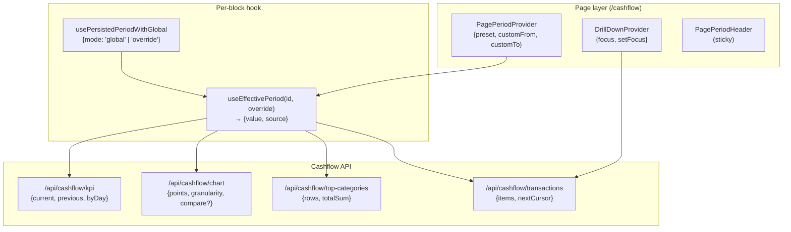

# Cashflow Blocks Guide (v0.20.0)

> **v0.20.0 update**: добавлен **page-level source filter** (см. `PageSourceProvider` / `useEffectiveSource`), **virtual sources** для bindings без `stat.*` блоков (см. `src/lib/blocks/virtual-sources.tsx`), **kpi.grid** блок (см. `docs/KPI_GRID.md`), **BLOCK_PRESETS** для одного клика (excel.cell + cashflow). Старые `stat.income / stat.expense / stat.balance` помечены `tags: ['legacy']` (работают, но новые пользователи добавляют через пресеты).


Полный гайд по cashflow-блокам с период-контекстом и drill-down.

## Архитектура



## Period unification

Блоки могут либо **слушать** период страницы (default), либо иметь **свой** период (override).

```typescript
// В блоке:
const { override, setOverride } = usePersistedPeriodWithGlobal({
  instanceId: instance.id,
  initial: cfg.periodOverride === null
    ? { mode: 'global' }
    : { mode: 'override', preset, customFrom, customTo },
});
const { value: period, source } = useEffectivePeriod(instance.id, override);
// source === 'override' → показываем lock-icon с возможностью вернуться к global
```

В Settings блока:
```typescript
<Switch
  checked={cfg.periodOverride === null}
  onCheckedChange={(v) =>
    setOverride(v ? null : { preset: 'mtd', customFrom: null, customTo: null })
  }
/>
```

Persistence: `localStorage[block:${instanceId}:period:v1]`.

## Drill-down

Любой агрегат (KPI / категория / бар чарта) может фокусировать список транзакций.

```typescript
// Источник (KPI/категория):
const drill = useDrillDown();
<div onClick={() => drill.setFocus({
  blockType: 'cashflow.transactions',
  filter: { type: 'income', categoryName: 'Реклама' }
})} />

// Приёмник (cashflow.transactions):
const drill = useDrillDown();
useEffect(() => {
  if (drill.focus?.blockType === 'cashflow.transactions') {
    applyFilters(drill.focus.filter);
  }
}, [drill.focus]);
```

UI feedback: блок-приёмник скроллится в видимость + получает `data-drill-active="1"` на 2 секунды (CSS pulse в `block-grid.css`).

Cross-page (с дашборда → на cashflow):
```typescript
import { drillDownUrl } from '@/lib/blocks/drill-down';
const href = drillDownUrl('/cashflow', 'cashflow.transactions', { type: 'income' });
// → /cashflow?drill_block_type=cashflow.transactions&drill_type=income
```

На receiver-странице:
```typescript
const sp = useSearchParams();
const focus = parseDrillDownFromSearchParams(new URLSearchParams(sp.toString()));
if (focus) drill.setFocus(focus);
```

## Блоки

### stat.income / stat.expense / stat.balance
- Density-aware StatCard:
  - **xs**: только число
  - **sm**: + label
  - **md**: + delta-badge (`+12% vs прошлый месяц`)
  - **lg**: + sparkline + lock-icon (если override)
- Клик → drill-down к `cashflow.transactions` с pre-filled type
- Publish: `value, valuePrev, deltaPct, count, __money, __labels`
- Goodness:
  - `income`: ↑ = green
  - `expense`: ↓ = green (хорошо когда снижается)
  - `balance`: tone по знаку

### stat.custom
- Гибкие фильтры: metric (income/expense/balance/count) + counterparty + categoryName + source
- Inline PeriodPicker в Settings + lock-icon на блоке
- Sparkline в `lg`
- Publish аналогично

### cashflow.top-categories
- Использует `/api/cashflow/top-categories` с period filter
- Показывает % от total (сумма / totalSum * 100)
- Клик по категории → drill-down с `categoryName` filter
- Empty state: CTA «Импортировать выписку»

### chart.cashflow
- `ChartShell` rich variant + `height='fill'`
- Compare overlay (`?compare=prev`) — пунктир прошлый период
- Auto-granularity: day ≤31d / week ≤120d / month иначе
- Bar / Line / Area + опц. накопительный баланс
- Density-aware header (скрывает badges на narrow/shortH)
- В DEFAULT_LAYOUTS.cashflow (12×5)

### cashflow.transactions
- Filters в header (type / counterparty / category)
- Cursor-based pagination (стабильно при изменениях)
- Виртуализация при >100 строк (`@tanstack/react-virtual`)
- CSV export через papaparse
- Drill-receive: получает focus от других блоков, подсвечивается

## API

### /api/cashflow/kpi
```
GET ?metric=income|expense|balance&preset=mtd&customFrom=...&customTo=...
    &counterparty=ТБанк&source=imap&categoryName=Реклама
```

Response:
```json
{
  "ok": true,
  "current": 123456,         // в копейках
  "previous": 100000,
  "count": 45,
  "prevCount": 38,
  "deltaPct": 23.456,
  "byDay": [{"date": "2026-05-01", "value": 10000}, ...]
}
```

### /api/cashflow/chart
```
GET ?preset=30d&granularity=auto&compare=prev
```

Response:
```json
{
  "ok": true,
  "granularity": "day",
  "points": [{"date": "2026-05-01", "income": 100, "expense": 50, "balance": 50}, ...],
  "compare": [...]
}
```

### /api/cashflow/transactions (с cursor pagination)
```
GET ?type=expense&counterparty=...&categoryName=Реклама&limit=50&cursorAt=...&cursorId=...
```

Response:
```json
{
  "ok": true,
  "items": [...],
  "nextCursor": { "at": "...", "id": "..." } | null
}
```

## Тесты

```bash
pnpm tsx scripts/test-cashflow-kpi.ts          # resolvePeriod, granularity, deltaPct
pnpm tsx scripts/test-page-period-context.ts   # storage parsing, useEffectivePeriod, drillDownUrl
```

## Best practices

1. **Никогда не делайте fetch в render** — всегда внутри `useEffect` с AbortController.
2. **Используйте `useEffectivePeriod`** во всех cashflow-блоках, не свои локальные period-стейты.
3. **Publish `__money` и `__labels`** для всех KPI блоков — это нужно computed.sum picker'у.
4. **Drill-down filter содержит period** (`from`, `to`) если drill идёт с per-block override — receiver применит этот период.
5. **Lock-icon** показывайте всегда когда `source === 'override'`, кликабельная для возврата к global.
