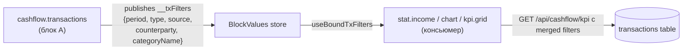
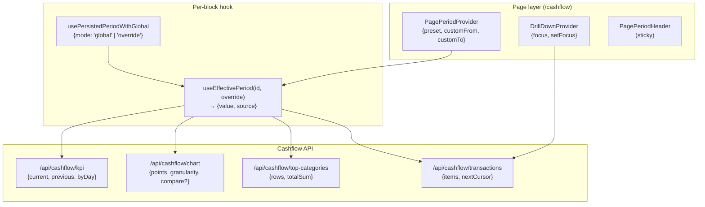

# Cashflow Blocks Guide (v0.22.1)

> **v0.22.1 update — UI patches**:
> 1. **`PagePeriodHeader` layout** (`src/components/blocks/page-period-header.tsx`): chevron сворачивания вынесен в отдельный header-row (Row 1: иконка + описание truncate + chevron `ml-auto shrink-0`; Row 2: SourceFilterChips + PeriodPicker, может wrap'аться). Раньше на узком экране PeriodPicker переносился и тащил chevron вниз — теперь chevron всегда в фиксированном top-right.
> 2. **`EmptySourcePlaceholder` semantic + compact** (`src/components/blocks/empty-source-placeholder.tsx`): разделение `title` (truncate, короткое название блока) и `subtitle` (line-clamp-1, muted, статус «источник не привязан»). Compact-режим уменьшает иконку (`h-6 w-6`), padding (`p-1.5`) и скрывает description — placeholder помещается в стандартный 2×2 блок. CTA-кнопка переименована в «Источник» (вместо «Выбрать источник»). Callers (`stat-custom`, `chart-cashflow`, `cashflow`, `kpi-grid`) обновлены: больше не склеивают `${title}: источник не привязан` в одну строку.
>
> **v0.21.0 update — Source Binding**: KPI / chart / top-categories / kpi.grid больше не делают tenant-wide запросы напрямую — они **привязываются** к конкретному блоку `cashflow.transactions` через настройки. Три режима: `empty` (дефолт для новых; placeholder с CTA), `global` (текущее поведение — page period+source), `block` (тянуть фильтры из view конкретного tx-блока). Auto-migration существующих layouts: если на странице есть `cashflow.transactions` — все consumer'ы auto-bind к первому; если нет — `empty`. См. подраздел [«Source Binding»](#source-binding-v0210) ниже.
>
> **v0.20.0 update**: добавлен **page-level source filter** (см. `PageSourceProvider` / `useEffectiveSource`), **virtual sources** для bindings без `stat.*` блоков (см. `src/lib/blocks/virtual-sources.tsx`), **kpi.grid** блок (см. `docs/KPI_GRID.md`), **BLOCK_PRESETS** для одного клика (excel.cell + cashflow). Старые `stat.income / stat.expense / stat.balance` помечены `tags: ['legacy']` (работают, но новые пользователи добавляют через пресеты).

## Source Binding (v0.21.0)

### Зачем

До v0.21.0 7 cashflow-блоков (`stat.income/expense/balance/custom`, `cashflow.top-categories`, `chart.cashflow`, `kpi.grid`) независимо ходили в tenant-wide `/api/cashflow/*` query. Никакой связи с блоком `cashflow.transactions` не было — даже в mindmap. Пользователь видел одинаковые 643 442 ₽ на разных страницах и не понимал, откуда они.

Теперь каждый consumer **явно** привязан к источнику.

### Три режима (per block)

```ts
type SourceBinding =
  | { mode: 'empty' }                                    // дефолт для новых блоков
  | { mode: 'global' }                                   // current behavior, opt-in
  | { mode: 'block'; blockId: string; pageKey?: string } // bound к cashflow.transactions
```

| Режим | Поведение |
|-------|-----------|
| `empty` | Блок показывает `EmptySourcePlaceholder` с CTA «Выбрать источник». Никаких запросов. |
| `global` | Tenant-wide query как раньше: фильтры берутся из page-level period + source (`useEffectivePeriod` / `useEffectiveSource`). |
| `block` | Фильтры тянутся из view конкретного `cashflow.transactions` блока (его published `__txFilters`). |

### Data flow для `mode: 'block'`



Для cross-page (dashboard → /cashflow): `/api/blocks/sources` возвращает `txFilters` field для tx-блоков; будущая итерация подключит его к `useBoundTxFilters` через `useAvailableBlockSources()`.

### Auto-migration legacy блоков

При первой загрузке layout'а `sanitizeBlocks` применяет `applySourceBindingMigration`:

- Для каждого блока из `BOUND_BLOCK_TYPES` без `sourceBinding` поля:
  - Если на странице ЕСТЬ `cashflow.transactions` → `{mode: 'block', blockId: <первый tx>}`.
  - Иначе → `{mode: 'empty'}`.
- Idempotent: повторная миграция не меняет уже привязанные блоки.

**Visual regression**: на дашборде, где нет `cashflow.transactions` блока, KPI/chart/top-categories станут пустыми (placeholder). Это **намеренное** поведение — пользователь явно выбирает источник.

### `cashflow.transactions` как источник

Расширенный `TxListConfig`:

```ts
type TxListConfig = {
  // view-defining defaults (одновременно UI-init + публикуется в __txFilters):
  defaultPeriodOverride?: PeriodOverride | null;
  defaultSourceOverride?: string | null;
  defaultType?: 'income' | 'expense' | null;
  defaultCategoryName?: string;
  defaultCounterparty?: string;
  // + другие поля (cursor, columns, etc.)
};
```

`useBlockValuePublisher` публикует:
```
__txFilters: JSON.stringify({
  period: defaultPeriodOverride,
  type:   defaultType,
  source: defaultSourceOverride,
  counterparty: defaultCounterparty,
  categoryName: defaultCategoryName,
});
```

Runtime-изменения юзером фильтров **не** влияют на bindings — это ephemeral UI state. Только `default*` поля = публичный view.

### Резолвинг для consumer'а

```ts
const sourceBinding = cfg.sourceBinding ?? DEFAULT_SOURCE_BINDING;
const boundFilters = useBoundTxFilters(sourceBinding);

if (sourceBinding.mode === 'empty')       return <EmptySourcePlaceholder ... />;
if (boundFilters?.kind === 'missing')     return <EmptySourcePlaceholder ... />;

const filters = boundFilters?.kind === 'filters'
  ? boundFilters.filters
  : null;

const period = filters?.period ?? pagePeriod;       // bound > page > default
const source = filters?.source === undefined        // undefined = page-source,
  ? pageSource                                       // null = «все источники» явно
  : filters.source;
// ... передаём в /api/cashflow/kpi
```

### kpi.grid: block-level + per-cell

`kpi.grid` имеет 2 уровня binding'а:

```ts
type KpiGridConfig = {
  defaultSourceBinding?: SourceBinding;  // для всех ячеек без override
  cells: Array<{
    sourceBindingOverride?: SourceBinding; // приоритет над default
    // ...
  }>;
};
```

Резолвинг: `cell.sourceBindingOverride ?? config.defaultSourceBinding ?? {mode:'empty'}`. Empty per-cell → компактный placeholder в ячейке. Block-level empty без per-cell override → полноблочный placeholder.

### UI

- **Общая секция «Источник данных»** наверху таба «Параметры» в `BlockSettingsDialog` для всех `BOUND_BLOCK_TYPES`. Avoids дублирование в каждой `SettingsForm`.
- **`SourceBindingPicker`** (`src/components/blocks/source-binding-picker.tsx`) — tabs «Пусто / Глобально / Из блока» + dropdown tx-блоков на странице.
- **kpi.grid**: дополнительный per-cell `SourceBindingPicker` в expanded cell row, с кнопкой «Наследовать» для сброса override.

### Mindmap

`BlockRelationsOverlay` рисует edges с `kind='data-source'` изумрудным (`#10b981`), толщиной 2.5px. Cross-page edges — пунктиром (`6 4`).

### Файлы

| Файл | Назначение |
|------|-----------|
| `src/lib/blocks/source-binding.ts` | Pure utilities: const, migration, edges (server-safe). |
| `src/lib/blocks/use-bound-tx-filters.ts` | React hook для consumer'ов. |
| `src/components/blocks/source-binding-picker.tsx` | UI компонент привязки. |
| `src/components/blocks/empty-source-placeholder.tsx` | Placeholder для empty/missing. |
| `scripts/test-source-binding.ts` | 40 unit-тестов. |

---


Полный гайд по cashflow-блокам с период-контекстом и drill-down.

## Архитектура



## Period unification

Блоки могут либо **слушать** период страницы (default), либо иметь **свой** период (override).

```typescript
// В блоке:
const { override, setOverride } = usePersistedPeriodWithGlobal({
  instanceId: instance.id,
  initial: cfg.periodOverride === null
    ? { mode: 'global' }
    : { mode: 'override', preset, customFrom, customTo },
});
const { value: period, source } = useEffectivePeriod(instance.id, override);
// source === 'override' → показываем lock-icon с возможностью вернуться к global
```

В Settings блока:
```typescript
<Switch
  checked={cfg.periodOverride === null}
  onCheckedChange={(v) =>
    setOverride(v ? null : { preset: 'mtd', customFrom: null, customTo: null })
  }
/>
```

Persistence: `localStorage[block:${instanceId}:period:v1]`.

## Drill-down

Любой агрегат (KPI / категория / бар чарта) может фокусировать список транзакций.

```typescript
// Источник (KPI/категория):
const drill = useDrillDown();
<div onClick={() => drill.setFocus({
  blockType: 'cashflow.transactions',
  filter: { type: 'income', categoryName: 'Реклама' }
})} />

// Приёмник (cashflow.transactions):
const drill = useDrillDown();
useEffect(() => {
  if (drill.focus?.blockType === 'cashflow.transactions') {
    applyFilters(drill.focus.filter);
  }
}, [drill.focus]);
```

UI feedback: блок-приёмник скроллится в видимость + получает `data-drill-active="1"` на 2 секунды (CSS pulse в `block-grid.css`).

Cross-page (с дашборда → на cashflow):
```typescript
import { drillDownUrl } from '@/lib/blocks/drill-down';
const href = drillDownUrl('/cashflow', 'cashflow.transactions', { type: 'income' });
// → /cashflow?drill_block_type=cashflow.transactions&drill_type=income
```

На receiver-странице:
```typescript
const sp = useSearchParams();
const focus = parseDrillDownFromSearchParams(new URLSearchParams(sp.toString()));
if (focus) drill.setFocus(focus);
```

## Блоки

### stat.income / stat.expense / stat.balance
- Density-aware StatCard:
  - **xs**: только число
  - **sm**: + label
  - **md**: + delta-badge (`+12% vs прошлый месяц`)
  - **lg**: + sparkline + lock-icon (если override)
- Клик → drill-down к `cashflow.transactions` с pre-filled type
- Publish: `value, valuePrev, deltaPct, count, __money, __labels`
- Goodness:
  - `income`: ↑ = green
  - `expense`: ↓ = green (хорошо когда снижается)
  - `balance`: tone по знаку

### stat.custom
- Гибкие фильтры: metric (income/expense/balance/count) + counterparty + categoryName + source
- Inline PeriodPicker в Settings + lock-icon на блоке
- Sparkline в `lg`
- Publish аналогично

### cashflow.top-categories
- Использует `/api/cashflow/top-categories` с period filter
- Показывает % от total (сумма / totalSum * 100)
- Клик по категории → drill-down с `categoryName` filter
- Empty state: CTA «Импортировать выписку»

### chart.cashflow
- `ChartShell` rich variant + `height='fill'`
- Compare overlay (`?compare=prev`) — пунктир прошлый период
- Auto-granularity: day ≤31d / week ≤120d / month иначе
- Bar / Line / Area + опц. накопительный баланс
- Density-aware header (скрывает badges на narrow/shortH)
- В DEFAULT_LAYOUTS.cashflow (12×5)

### cashflow.transactions
- Filters в header (type / counterparty / category)
- Cursor-based pagination (стабильно при изменениях)
- Виртуализация при >100 строк (`@tanstack/react-virtual`)
- CSV export через papaparse
- Drill-receive: получает focus от других блоков, подсвечивается

## API

### /api/cashflow/kpi
```
GET ?metric=income|expense|balance&preset=mtd&customFrom=...&customTo=...
    &counterparty=ТБанк&source=imap&categoryName=Реклама
```

Response:
```json
{
  "ok": true,
  "current": 123456,         // в копейках
  "previous": 100000,
  "count": 45,
  "prevCount": 38,
  "deltaPct": 23.456,
  "byDay": [{"date": "2026-05-01", "value": 10000}, ...]
}
```

### /api/cashflow/chart
```
GET ?preset=30d&granularity=auto&compare=prev
```

Response:
```json
{
  "ok": true,
  "granularity": "day",
  "points": [{"date": "2026-05-01", "income": 100, "expense": 50, "balance": 50}, ...],
  "compare": [...]
}
```

### /api/cashflow/transactions (с cursor pagination)
```
GET ?type=expense&counterparty=...&categoryName=Реклама&limit=50&cursorAt=...&cursorId=...
```

Response:
```json
{
  "ok": true,
  "items": [...],
  "nextCursor": { "at": "...", "id": "..." } | null
}
```

## Тесты

```bash
pnpm tsx scripts/test-cashflow-kpi.ts          # resolvePeriod, granularity, deltaPct
pnpm tsx scripts/test-page-period-context.ts   # storage parsing, useEffectivePeriod, drillDownUrl
```

## Best practices

1. **Никогда не делайте fetch в render** — всегда внутри `useEffect` с AbortController.
2. **Используйте `useEffectivePeriod`** во всех cashflow-блоках, не свои локальные period-стейты.
3. **Publish `__money` и `__labels`** для всех KPI блоков — это нужно computed.sum picker'у.
4. **Drill-down filter содержит period** (`from`, `to`) если drill идёт с per-block override — receiver применит этот период.
5. **Lock-icon** показывайте всегда когда `source === 'override'`, кликабельная для возврата к global.
