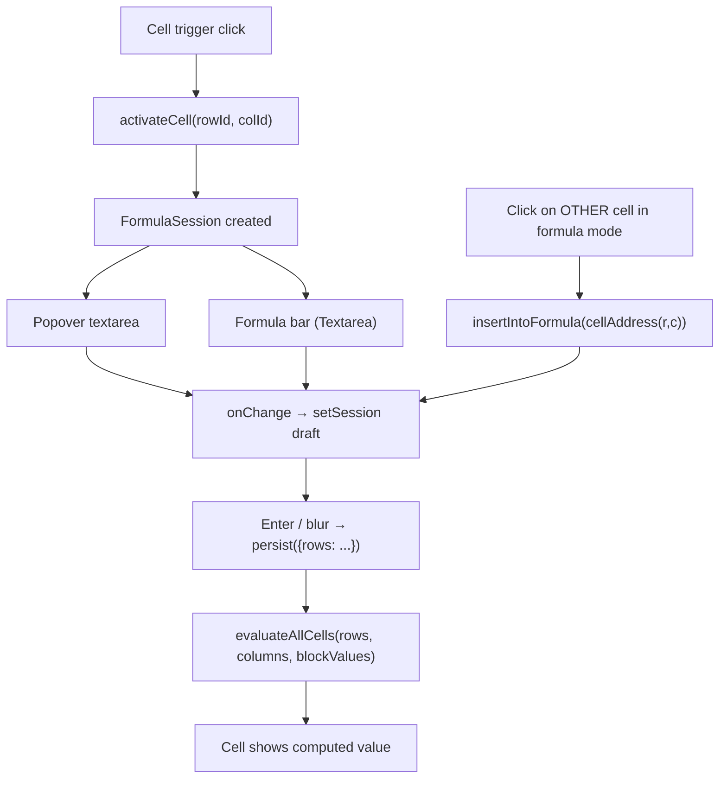

# Блок «Данные» (`custom.data`) — гибридный formula UX

> Версия: v0.22.0 · Файл: [src/lib/blocks/catalog/custom-data.tsx](../src/lib/blocks/catalog/custom-data.tsx) · Engine: [src/lib/blocks/custom-data-formulas.ts](../src/lib/blocks/custom-data-formulas.ts)

## TL;DR

Блок «Данные» — flexible spreadsheet-like grid с поддержкой формул (`=A1+B1`, `=SUM(...)`, cross-block `@blockId/colA`, named refs `@row.col`). Редактирование значений и формул работает через два связанных интерфейса: **inline popover** над ячейкой и **formula bar** под header'ом блока. Оба синхронизированы общим стейтом и поддерживают **cell-click-to-insert** для быстрой вставки ссылок.

## Режимы редактирования

При фокусе на ячейке (`activateCell()`) создаётся **`FormulaSession`**:

```ts
type FormulaSession = {
  rowId: string;
  columnId: string;
  mode: 'value' | 'formula' | 'binding';
  valueDraft: string;          // черновик литерала
  formulaDraft: string;        // черновик формулы (начинается с `=`)
  caretPos: number | null;     // позиция каретки в formulaDraft
};
```

Текущий session — единственный источник истины. И popover, и formula bar читают и пишут в один и тот же session. При commit (`Enter` / blur popover'a) — записываются в `block.config.rows[r].cells[c]`.

### Режим `value` (литерал)
- Дефолт для новых ячеек.
- Ввод числа / текста / `null` (пустая ячейка).
- Tab «Значение» в popover'е.
- Formula bar пустой или показывает текущее значение.

### Режим `formula` (вычисляемое)
- Активируется при вводе `=` в любое поле (popover textarea или formula bar).
- Cross-block: `=@KPI_ID/colA` ссылается на ячейку другого блока (см. `custom-data-formulas.ts`).
- Named refs: `=@row1.colA` использует `row.label`/`column.label` как алиасы.
- **Cell-click-to-insert** (см. ниже).

### Режим `binding` (биндинг к external source)
- Tab «Связь» в popover'е.
- Привязка к `cashflow.transactions` блоку, `period.summary`, `kpi.*` — ячейка становится read-only, значение тянется из BlockValues store.
- Не пересекается с formula-режимом (биндинг ≠ формула с `@blockId`).

## Cell-click-to-insert (pick mode)

Когда `formulaSession.mode === 'formula'`, **клик по любой другой ячейке этого же блока** вызывает:

```ts
insertIntoFormula(prev, cellAddress(rowIdx, colIdx))
// например: prev.formulaDraft = '=A1+', click on B2 → '=A1+B2', caret в конце
```

Что происходит:
1. Popover **не** закрывается (защита через `onInteractOutside={(e) => e.preventDefault()}`).
2. Анкор popover'а **не** меняется — окно остаётся над исходной ячейкой.
3. Вставка идёт в позицию `caretPos`, draft и `caretPos` обновляются синхронно.
4. Курсор-стиль на «других» ячейках — `cursor-cell` (визуальная индикация pick-режима).

Это эталонная UX-механика Excel / Google Sheets: пользователь не должен ловить точную ячейку клавишами — клик мышкой работает в любом порядке.

## Draggable popover

Popover можно перетащить за заголовок (drag-handle с иконкой `Move`):
- Реализация: нативный `pointermove` + CSS `transform: translate(dx, dy)`, без зависимости от `@dnd-kit/core` (popover не должен попадать в drag-context блоков).
- Offset хранится в `popoverOffset` state (per-session). Сбрасывается при закрытии.
- `clamp()` границами viewport'а (через `getBoundingClientRect()`).

Зачем: окно может перекрывать ячейку-цель в pick-mode, и пользователь должен иметь возможность отодвинуть его, не теряя session.

## Settings toggle: `cellPopoverEnabled`

Поле в `CustomDataSettings`:
```ts
cellPopoverEnabled: z.boolean().optional() // default: true
```

- **Включено** (default): клик по ячейке → popover + formula bar (Notion-style).
- **Выключено**: popover не показывается, клик по ячейке только активирует session — редактирование через formula bar (Excel-style). Pick-mode по-прежнему работает.

Подсказка под чекбоксом:
> «Если выключить — работает как Excel: редактирование через строку формул сверху, клик по ячейке вставляет ссылку.»

## Hint plate

При первом открытии блока показывается одноразовая подсказка над formula-bar:
> «💡 Клик по ячейке вставляет ссылку. Окно можно перетащить за заголовок. Можно отключить окно в настройках.»

Закрывается крестиком, флаг — `localStorage['custom-data:formula-hint:dismissed']`.

## Data flow



## Тесты

- [scripts/test-formula-pick-mode.ts](../scripts/test-formula-pick-mode.ts) — `cellAddress`, `colLabel`, `insertIntoFormula` (caret management, auto-prefix `=`).
- [scripts/test-custom-data-formulas.ts](../scripts/test-custom-data-formulas.ts) — evaluator (литералы, A1, ranges, named refs, cross-block, cycle detection).

Запуск:
```bash
pnpm tsx scripts/test-formula-pick-mode.ts
pnpm tsx scripts/test-custom-data-formulas.ts
```

## Известные ограничения

- Drag-offset сбрасывается при закрытии popover'а (не персистится между сессиями — это by design, окно всегда открывается над исходной ячейкой).
- Pick-mode работает только в пределах текущего блока. Cross-block ссылки `@blockId/cell` пока вводятся вручную (через autocomplete в textarea — Phase 2 roadmap).
- При `cellPopoverEnabled === false` нет binding-picker'а — нужно открыть Settings блока. Это компромисс ради упрощённого UI.
