# Блок «Данные» (`custom.data`) — sheet-style formula UX

> Версия: v0.23.2 · Файл: [src/lib/blocks/catalog/custom-data.tsx](../src/lib/blocks/catalog/custom-data.tsx) · Engine: [src/lib/blocks/custom-data-formulas.ts](../src/lib/blocks/custom-data-formulas.ts)

## TL;DR

Блок «Данные» — flexible spreadsheet-like grid с поддержкой формул (`=A1+B1`, `=SUM(...)`, cross-block `@blockId/colA`, named refs `@row.col`). С v0.22.5 редактирование значений и формул работает в стиле блока «Таблица Excel» (`sheet.tsx`):

- **Inline `<input>`** в активной ячейке (autoFocus при клике).
- **Formula bar** под header'ом блока (всегда editable + operator toolbar).
- **Cell-click-to-insert** для вставки ссылок в режиме формулы.
- **@связать** кнопка для binding'а или вставки `@ref`-токена в формулу.

Popover с табами «Значение / Формула / Связь», `CurrencyInput`-блокировка операторов и draggable popover **удалены** — это упрощает UX и убирает баги (см. ниже).

## Editing session (`EditSession`)

При клике на ячейку (`activateCell()`) создаётся единая editing session:

```ts
type EditSession = {
  rowId: string;
  columnId: string;
  draft: string;               // ЕДИНЫЙ черновик: значение ИЛИ формула
  caretPos: number | null;     // позиция каретки (для cell-pick)
  lastFocused: 'inline' | 'bar'; // куда возвращать focus после insert
};

// Режим формулы определяется автоматически:
const isFormula = draft.startsWith('=');
```

Single source of truth: и inline-input в ячейке, и formula bar пишут в один `session.draft`. При commit (Enter / blur) draft записывается в `block.config.rows[r].cells[c].v`. Если строка начинается с `=` — сохраняется как формула (`v = '=A1+B1'`), иначе — как литерал.

## Formula bar (всегда editable)

Активируется при `activeCell != null`. Состоит из:

1. **Адрес ячейки** (`A1`, `B2`…) — read-only chip.
2. **Иконка `fx`** — индикатор режима формулы.
3. **`<input>`** — основное поле ввода, `value = session.draft`.
4. **Бэйдж `fx`** — показывается когда `isFormula(draft)`.
5. **Кнопка «отвязать»** — если ячейка binding'нута к источнику (`cell.ref != null`).
6. **Кнопка «@связать»** — открывает `CellRefPickerDialog`. Поведение зависит от режима:
   - В режиме формулы → вставляет `@blockId.field` в draft.
   - Не в режиме формулы → создаёт binding (`cell.ref = ...`), session закрывается.
7. **Кнопка «очистить»** (Trash2) — очищает ячейку, закрывает session.
8. **Кнопка «закрыть»** (X) — отменяет редактирование.

## Operator toolbar (только в режиме формулы)

Под formula bar появляется компактная панель кнопок:

```
+  −  ×  /  (  )  ,  :  |  SUM  AVG  MIN  MAX  COUNT
```

Каждая кнопка вставляет соответствующий символ/функцию в `draft` на позиции каретки (через общую утилиту `insertIntoDraft`). После клика focus возвращается в input, где был последний раз (через `session.lastFocused`).

## Inline cell editing

Активная ячейка рендерит `<input>` вместо обычной `CellTriggerButton`:
- `autoFocus` при первой активации.
- `value = session.draft` — синхронизирован с formula bar.
- `onKeyDown`: `Enter` → commit + close, `Escape` → cancel, `Tab` / `Shift+Tab` → commit + перейти к следующей/предыдущей колонке.
- `onBlur` → commit (с учётом cell-pick: при клике на другую ячейку blur не закрывает редактор, потому что мы перехватываем клик до blur'а).

Border активной ячейки подсвечивается `border-primary + ring`.

## Cell-click-to-insert (pick mode)

Когда `draft.startsWith('=')`, клик по другой ячейке этого же блока вставляет её адрес в draft:

```ts
// pseudocode
function handleCellClick(rowId, columnId) {
  if (session && isFormulaDraft(session.draft) && cell !== activeCell) {
    const addr = cellAddress(rIdx, cIdx);
    insertIntoDraft(session, addr, { forceFormula: true });
    return; // NOT activateCell — оставляем активную как есть
  }
  activateCell(rowId, columnId);
}
```

Что происходит:
1. Активная ячейка **не** меняется — formula bar и inline-input остаются на исходной.
2. Адрес ячейки (`B2`) вставляется в `session.draft` на позиции каретки.
3. Focus возвращается в input, где была каретка (inline или formula bar). С **v0.23.2** восстановление каретки — через `useLayoutEffect + pendingCaretRef` (синхронное, после commit, до paint), а **позиция каретки читается из DOM `input.selectionStart`** в момент вставки, а не из устаревшего React-state. Это устраняет баг, когда печать после cell-pick попадала в неправильное место (например, `*60=B1` вместо `=B1*60`).
4. Курсор-стиль на «других» ячейках — `cursor-cell` (визуальная индикация pick-режима).

Это эталонная UX-механика Excel / Google Sheets: пользователь не должен ловить точную ячейку клавишами — клик мышкой работает в любом порядке.

## Binding (cell.ref)

Binding — это **отдельное persistent состояние ячейки**, не входящее в session. Когда `cell.ref != null`:
- Ячейка показывает значение из `liveValues[ref]` (с fallback на `cell.v`).
- В формулах других ячеек binding-source = `cell.v` (как обычное значение).
- Visual: amber border + `Link2` icon в углу.

Создание binding:
- Кликнуть «@связать» в formula bar когда `draft` НЕ начинается с `=`.
- Открывается `CellRefPickerDialog` (full-size dialog).
- Выбор блока/поля → `cell = { v: liveValue, ref: 'blockId.field', isMoney: ... }`.

Удаление binding: кнопка «отвязать» в formula bar → `cell.ref = undefined`, `v` остаётся как snapshot.

## insertIntoDraft (общая утилита, экспортируется для тестов)

```ts
export function insertIntoDraft(
  prev: { draft: string; caretPos: number | null },
  text: string,
  options: { forceFormula?: boolean } = {},
): { draft: string; caretPos: number }
```

Используется в:
- `handleCellClick` → cell-pick (`forceFormula: true`).
- `insertOperator` → operator toolbar (`forceFormula: true`).
- `pickRefForCell` (formula mode) → @-ссылка (`forceFormula: true`).

Если `forceFormula=true` и draft не начинается с `=`, добавляется автоматически. Pure-функция → покрыта unit-тестами.

## Data flow

```mermaid
graph TD
  Cell["Cell click"] --> Activate["activateCell(rowId, colId)"]
  Activate --> Session["EditSession { draft, caretPos, lastFocused }"]
  Session --> Inline["Inline <input>"]
  Session --> Bar["Formula bar <input>"]

  Inline --> SyncDraft["onChange → setSession({ draft })"]
  Bar --> SyncDraft

  CellInPick["Click on OTHER cell while isFormula"] --> InsertRef["insertIntoDraft(addr, forceFormula=true)"]
  InsertRef --> SyncDraft

  OpClick["Operator/SUM button"] --> InsertRef
  AtClick["@связать (formula mode)"] --> InsertRef
  AtClickBinding["@связать (value mode)"] --> CreateBinding["cell.ref = 'blockId.field'"]

  SyncDraft --> Commit["Enter / Tab / blur → updateCell()"]
  Commit --> Engine["evaluateAllCells(rows, columns, liveValues)"]
  Engine --> Render["Cell shows computed value"]
```



## Тесты

- [scripts/test-formula-pick-mode.ts](../scripts/test-formula-pick-mode.ts) — `cellAddress`, `colLabel`, `insertIntoDraft` (caret management, auto-prefix `=`, cell-pick + operator scenarios).
- [scripts/test-custom-data-formulas.ts](../scripts/test-custom-data-formulas.ts) — evaluator (литералы, A1, ranges, named refs, cross-block, cycle detection).

Запуск:
```bash
pnpm tsx scripts/test-formula-pick-mode.ts
pnpm tsx scripts/test-custom-data-formulas.ts
```

## Что было удалено в v0.22.5 (миграция с popover-UX)

| Удалено | Причина |
|---|---|
| Popover с табами «Значение/Формула/Связь» | Слишком много кликов; user-confusion: «куда печатать?» |
| `CurrencyInput` в табе «Значение» | Блокировал ввод `+ − ( )` через `e.preventDefault()` |
| Draggable popover | Workaround для перекрытия ячейки-цели; больше не нужен — popover'а нет |
| `cellPopoverEnabled` setting | Был toggle Excel ↔ Notion-mode; теперь всегда Excel |
| Hint plate про popover | Подсказка про несуществующую фичу |
| `lastFocusedFormulaRef`, `popoverFormulaRef` | Sync двух textarea — теперь один input на каждое место |
| `FormulaSession.{mode, valueDraft, formulaDraft}` | Упрощено до `draft` + автодетект `isFormula` |

Backward compatibility: старые конфиги с `cellPopoverEnabled: false` парсятся без ошибок (поле игнорируется через z.passthrough).

## Подсветка строк / колонок (v0.23.2)

Каждая строка и колонка может иметь персистентную цветовую подсветку через поле `highlight` — ID цвета из палитры:

```ts
const HIGHLIGHT_PALETTE = ['yellow', 'green', 'blue', 'red', 'purple', 'orange'] as const;
type HighlightId = (typeof HIGHLIGHT_PALETTE)[number];

// schema (zod): z.string().nullable().optional()
type Row = { id; label; cells; highlight?: HighlightId | null };
type Column = { id; label; format; ... ; highlight?: HighlightId | null };
```

Применяется как:
- На строку — `bg-{color}-50/60 dark:bg-{color}-950/30` (full-row tint).
- На колонку — `bg-{color}-50/60 dark:bg-{color}-950/30` (только на header).

Если строка и колонка обе подсвечены — приоритет визуально у row (полная строка), но cell наследует tint в зоне пересечения через `colHighlight && !isActive`.

UI выбора:
- Доступен только через **bulk-toolbar** (после выделения 1+ строк / колонок).
- Кнопка «Подсветить» открывает `HighlightPalettePopover` с 6 цветами + «Снять подсветку» (`Ban` icon).
- Применяется ко всем выделенным сразу.

Backward-compat: configs без `highlight` парсятся без изменений; `isHighlightId()` strip-фильтрует невалидные значения.

## Multi-select (v0.23.2)

Excel-style выделение строк и колонок:

| Действие | Результат |
|---|---|
| Клик по drag-handle строки/колонки (без movement) | Select (заменяет выделение) |
| Shift+клик | Extend (диапазон от last-clicked) |
| Cmd / Ctrl + клик | Toggle |
| Drag (movement >4px) | Реордер (dnd-kit activationConstraint: distance: 4) |
| Клик по другой строке / в другую секцию | Выделение очищается |

Visual:
- Selected строка — `ring-2 ring-primary/60 ring-offset-1`.
- Selected колонка — `ring-2 ring-primary/60` (на header).
- Drag-handle отображает `<CheckSquare />` когда строка выделена (вместо `<GripVertical />`).
- Bulk-toolbar появляется под formula-bar когда есть выделение:
  - `Подсветить` → палитра.
  - `Удалить` → массовое удаление строк и/или колонок (вместе с cells в удаляемых колонках).
  - `Снять` → clear selection.

Выделение **строк** и **колонок** взаимоисключающие: выбор одной секции очищает другую.

## Известные ограничения

- Cross-block ссылки `@blockId.field` вводятся через picker (кнопка «@связать»), inline autocomplete пока нет — Phase 2 roadmap.
- При редактировании binding'нутой ячейки (`cell.ref != null`) draft изначально пустой; чтобы получить раздельные value vs binding, нужно сначала «отвязать».
- Multi-cell selection (range of cells across rows × cols) пока нет — только целые строки или целые колонки. Если нужны блочные range — следующая итерация.
- Подсветка применяется только через bulk-toolbar; per-row/per-col правый клик с context-menu — Phase 2.
