# Юнит-экономика — CRUD-вкладки

> Версия: v0.22.0 · Schema: [src/lib/db/schema/unit-economics-tabs.ts](../src/lib/db/schema/unit-economics-tabs.ts) · API: [src/app/api/unit-economics/tabs/route.ts](../src/app/api/unit-economics/tabs/route.ts) · UI: [src/app/(app)/unit-economics/unit-economics-client.tsx](../src/app/(app)/unit-economics/unit-economics-client.tsx)

## TL;DR

Раньше вкладки в `/unit-economics` были hardcoded (Ozon, Ozon Multi, Yandex, My Store). С v0.22.0 — динамические, tenant + user-scoped. Пользователь может **переименовывать**, **создавать новые** (пустые или клонированные из существующих), **дублировать** и **удалять**. Каждая вкладка соответствует уникальному `pageKey`, под который сохраняется отдельный `block_layouts` row.

## Схема БД

```ts
pgTable('unit_economics_tabs', {
  id: uuid().defaultRandom().primaryKey(),
  tenantId: uuid('tenant_id').notNull()
    .references(() => tenants.id, { onDelete: 'cascade' }),
  userId: uuid('user_id').notNull(),
  pageKey: text('page_key').notNull(),
  label: text('label').notNull(),
  icon: text('icon'),              // Lucide icon name (например, 'ShoppingCart')
  order: integer().notNull().default(0),
  kind: text({ enum: ['default', 'custom'] }).notNull().default('custom'),
  defaultKey: text('default_key'), // для default: 'ozon' | 'ozon-multi' | 'yandex' | 'my-store'
  createdAt, updatedAt,
}, (t) => ({
  unique: uniqueIndex('uet_tenant_user_pk').on(t.tenantId, t.userId, t.pageKey),
}));
```

Уникальный constraint `(tenantId, userId, pageKey)` — один пользователь не может иметь два таба с одинаковым `pageKey`.

## Default vs custom tabs

| Атрибут | Default | Custom |
|---|---|---|
| `kind` | `'default'` | `'custom'` |
| `defaultKey` | `'ozon'` / `'ozon-multi'` / `'yandex'` / `'my-store'` | `null` |
| `pageKey` | `'unit-economics-{defaultKey}'` | `'unit-economics-custom-{nanoid8()}'` |
| Удаление | **Soft** (помечается hidden) | **Hard** + cleanup `block_layouts` |
| Создание | Auto-seed при первом GET | Через `POST /api/unit-economics/tabs` |

Default-вкладки seed'ятся при первом GET, если у пользователя их нет:

```ts
export const DEFAULT_UNIT_TABS = [
  { defaultKey: 'ozon',       label: 'Ozon · Один магазин',  icon: 'ShoppingCart', order: 0 },
  { defaultKey: 'ozon-multi', label: 'Ozon · Несколько',     icon: 'Store',        order: 1 },
  { defaultKey: 'yandex',     label: 'Яндекс Маркет',        icon: 'Package',      order: 2 },
  { defaultKey: 'my-store',   label: 'Мой магазин',          icon: 'Warehouse',    order: 3 },
];
```

## API

### `GET /api/unit-economics/tabs`
Возвращает все вкладки текущего user'а. Если пусто — seed'ит 4 default'а.

```json
[
  { "id": "...", "pageKey": "unit-economics-ozon", "label": "Ozon · Один магазин",
    "icon": "ShoppingCart", "order": 0, "kind": "default", "defaultKey": "ozon" },
  ...
]
```

### `POST /api/unit-economics/tabs`
Создаёт новую вкладку. Поля:
- `label: string` (обязательно)
- `icon?: string` (Lucide icon name)
- `cloneFromPageKey?: string` — если задан, копирует `block_layouts` исходной страницы.

Возвращает созданную запись.

```bash
# Пустая вкладка
curl -X POST /api/unit-economics/tabs -d '{"label":"Эксперимент","icon":"FlaskConical"}'

# Клон из my-store
curl -X POST /api/unit-economics/tabs \
  -d '{"label":"Мой магазин (копия)","cloneFromPageKey":"unit-economics-my-store"}'
```

### `PATCH /api/unit-economics/tabs/[id]`
Обновляет label / icon / order. Реализован inline rename (двойной клик) и reorder (`order` field).

### `DELETE /api/unit-economics/tabs/[id]`
- Custom: hard delete + cleanup `block_layouts` для этого `pageKey`.
- Default: soft delete (hidden flag — реализация через `order < 0` или отдельное поле, см. queries).

## UI flow

```mermaid
graph TD
  Load["Server-side: listTabs(userId)"] --> Layouts["Для каждого: loadLayout(pageKey)"]
  Layouts --> Client["UnitEconomicsClient(initialTabs)"]

  Click["Click on tab"] --> Active["setActive(tabId)"]
  Active --> BlockGrid["BlockGrid pageKey={tab.pageKey}"]

  DoubleClick["Double-click on tab"] --> Inline["<input> editor"]
  Inline --> Save["PATCH /api/unit-economics/tabs/[id]"]

  Menu["DropdownMenu (⋮)"] --> Actions{Action}
  Actions -->|Rename| Inline
  Actions -->|Duplicate| Clone["POST с cloneFromPageKey"]
  Actions -->|Delete| Confirm["AlertDialog"]
  Confirm --> Delete["DELETE /api/unit-economics/tabs/[id]"]

  Plus["Кнопка +"] --> CreateDialog["CreateTabDialog"]
  CreateDialog --> Empty["POST без cloneFromPageKey"]
  CreateDialog --> Copy["POST с cloneFromPageKey"]
```



## Cross-references

Custom-вкладки доступны как источники для `@blockId/cell` ссылок в других блоках. `/api/blocks/sources` динамически резолвит лейблы:

```ts
// /api/blocks/sources/route.ts
const unitTabsList = await db.select({ pageKey, label })
  .from(unitEconomicsTabs)
  .where(eq(tenantId, ctx.tenantId));

const customLabels = new Map(unitTabsList.map((t) => [t.pageKey, t.label]));

function pageLabel(pageKey: string, customLabels?: Map<string, string>): string {
  if (customLabels?.has(pageKey)) return `Юнит-экономика · ${customLabels.get(pageKey)}`;
  // ... fallback на статические labels
}
```

Это означает, что вкладка «Эксперимент» с `pageKey = 'unit-economics-custom-abc12345'` будет показана в picker'е как **«Юнит-экономика · Эксперимент»**.

## Block marketplace для custom-вкладок

`BlockDef.pages` поддерживает wildcard `'unit-economics-custom-*'` — на custom-вкладках доступны все `unit.*` блоки (полный набор без фильтра).

```ts
// src/lib/blocks/catalog/unit-my-store-table.tsx
export const unitMyStoreTableBlockDef: BlockDef = {
  type: 'unit.my-store-table',
  pages: ['unit-economics-my-store', 'unit-economics-custom-*'],
  // ...
};
```

## Тесты

- [scripts/test-unit-tabs-crud.ts](../scripts/test-unit-tabs-crud.ts) — DEFAULT_UNIT_TABS, custom pageKey pattern, reorder, delete-with-fallback.

Запуск:
```bash
pnpm tsx scripts/test-unit-tabs-crud.ts
```

## Миграция

Новая таблица добавлена в `drizzle/0003_outstanding_energizer.sql`. Применить:

```bash
pnpm db:migrate
```

Existing пользователи получат default-вкладки автоматически при первом GET — backwards compatible.
